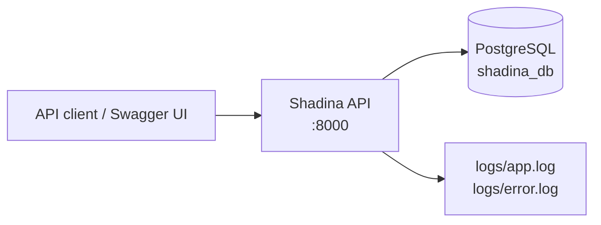

# 01. Project Overview

## Purpose and scope

Shadina is a small social-network **backend API** written in Go. It exposes JSON over HTTP for account
registration, login/token issuance, user lookup, following/unfollowing, a personalized feed, and basic post
management. Posts can carry tags and comments; the current API exposes comment **reading** through post
responses but does not expose comment creation, updating, or deletion.

The repository is a backend-only project:

- `cmd/api` is the HTTP server.
- `cmd/seed` inserts development data.
- `cmd/migrate/migrations` contains versioned SQL migrations, but `cmd/migrate` has **no Go entry point**.
- `web/` is empty. There is no frontend, static site, or server-side rendered UI.
- Swagger UI is served by the API itself, not by a separate documentation service.

The system is best described as a **layered modular monolith**: HTTP transport and middleware in `cmd/api`,
request/response types in `internal/dto`, SQL and persistence in `internal/storage`, and supporting utilities
in smaller packages. There is no separate service/domain layer; handlers orchestrate storage calls directly.

## Verified capabilities

| Capability | API | Status | Notes |
|---|---|---|---|
| Register a user | `POST /v1/auth/register` | Implemented | Public. Returns HTTP 200, not 201. Role is fixed to `role_id = 1`. |
| Issue a JWT | `POST /v1/auth/token` | Implemented | Email/password login. HS256, 72-hour expiry. No refresh token. |
| Health/liveness | `GET /v1/health` | Implemented | Always reports `ok`; does not check the database. |
| Heartbeat | `GET /ping` | Implemented | Chi `Heartbeat` middleware; body is `.` (not `pong`). |
| List users | `GET /v1/users` | Implemented | JWT required. No pagination. `role_id` is returned as `0` because the query omits it. |
| Retrieve a user | `GET /v1/users/{userID}` | Implemented | JWT required. Not-found and invalid-ID cases return HTTP 500. |
| Follow a user | `PUT /v1/users/{userID}/follow` | Implemented | JWT required. No request body is read. Duplicate/unknown targets produce HTTP 500. |
| Unfollow a user | `PUT /v1/users/{userID}/unfollow` | Implemented | JWT required. Missing relationships still return success. |
| Personalized feed | `GET /v1/users/{userID}/feeds` | Implemented | JWT required. Any authenticated user can request any `userID`. |
| List posts | `GET /v1/posts` | Implemented | JWT required. Returns all posts and comments; no pagination; N+1 comment queries. |
| Create a post | `POST /v1/posts` | Implemented | JWT required. Returns HTTP 200, although Swagger says 201. |
| Retrieve a post | `GET /v1/posts/{postID}` | Implemented | JWT required. Includes comments. |
| Update a post | `PATCH /v1/posts/{postID}` | Implemented | Owner or admin path. Admin path has a response-writing bug. |
| Delete a post | `DELETE /v1/posts/{postID}` | Implemented | Owner or admin path. Posts with comments fail on the foreign key. |
| Swagger UI | `GET /v1/swagger/*` | Implemented | Public; its spec URL is misconfigured. |
| Read comments | Embedded in post responses | Implemented | There is no standalone comment endpoint. |
| Create comments | — | Not Implemented | `CommentsStorage.Create` exists but no route calls it; only seed uses it. |
| Refresh/logout/revoke tokens | — | Not Implemented | No endpoint, no token blacklist, no refresh token. |
| Password reset/change | — | Not Implemented | — |
| Update/delete users | — | Not Implemented | — |
| Roles management | — | Not Implemented | Roles are seeded by migration; no CRUD. |
| Pagination for users/posts | — | Not Implemented | Only the feed accepts pagination parameters. |
| Metrics/tracing/profiling | — | Not Implemented | No Prometheus, OpenTelemetry, pprof, or request IDs. |
| Automated tests | — | Not Implemented | There are no `*_test.go` files. |
| Application container | — | Not Implemented | Compose runs PostgreSQL only; no Dockerfile exists. |
| CI/CD | — | Not Implemented | No CI configuration found. |

## Technology stack

Versions below come from `go.mod`, `go.sum`, `docker-compose.yaml`, and the installed toolchain used during
review.

| Component | Version / source | Role |
|---|---|---|
| Go | `go 1.25.4` in `go.mod`; installed `go1.25.4` | Language/runtime |
| chi | `github.com/go-chi/chi/v5 v5.2.5` | HTTP router and middleware |
| PostgreSQL | `postgres:18.4` image in Compose | Database |
| `lib/pq` | `v1.12.3` | PostgreSQL driver |
| `go-playground/validator` | `v10.30.4` | Request/pagination validation |
| `golang-jwt/jwt/v5` | `v5.3.1` | JWT signing and validation |
| `golang-jwt/jwt` (v3) | `v3.2.2+incompatible` | Declared but unused; `go mod why` reports it is not needed |
| `golang.org/x/crypto` | `v0.55.0` | bcrypt password hashing |
| `go.uber.org/zap` | `v1.28.0` | Structured file logging |
| `swaggo/swag` | `v1.16.6` (module), CLI `v1.16.4` during review | Swagger generation |
| `swaggo/http-swagger/v2` | `v2.0.2` | Swagger UI handler |
| `joho/godotenv` | `v1.5.1` | `.env` loading |
| Docker Compose | Compose file format without a top-level `version`; Compose v5.5.1 during review | Local PostgreSQL |
| golang-migrate CLI | `4.16.2` during review | Applying migrations |
| golangci-lint | `2.15.0` during review | Optional linting |

## Runtime topology

The only runtime dependencies are the API process, PostgreSQL, and the local filesystem for logs.

There are no external identity providers, message brokers, caches, object stores, email services, or
third-party APIs in the code. See [System context](diagrams/system-context.mmd).

## Repository map

| Path | Responsibility |
|---|---|
| `cmd/api` | HTTP server, routes, handlers, middleware, application wiring |
| `cmd/seed` | Development data seeder |
| `cmd/migrate/migrations` | SQL migrations (the directory has no `main.go`) |
| `internal/auth` | `Authenticator` interface and HS256 JWT implementation |
| `internal/consts` | Timeouts, `NOT_FOUND`, context key |
| `internal/db` | Database connection bootstrap and seed data generation |
| `internal/dto` | Request payloads and health payload |
| `internal/env` | String/integer environment helpers |
| `internal/response` | JSON response envelope and helpers |
| `internal/storage` | Storage facade, SQL queries, bcrypt password methods, pagination |
| `internal/utils` | JSON read/write helpers and global validator |
| `docs` | Generated Swagger template, JSON, and YAML |
| `scripts/init_db.sql` | Attempted DB initialization script; not used by Compose and not valid PostgreSQL as written |
| `web` | Empty directory; no web application |
| `logs` | Runtime log output; ignored by Git |
| `bin/main` | Tracked compiled binary; not part of the source build |

Detailed annotations are in [03. Project structure](03-project-structure.md).

## What a new developer should know first

1. The API starts from `cmd/api/main.go`; configuration is read from `.env` in the current working directory.
2. Protected routes require `Authorization: Bearer <JWT>`; the JWT is issued by `POST /v1/auth/token`.
3. The database is PostgreSQL; apply migrations with `make migrate-up` and create development data with
   `go run ./cmd/seed` (the `make seed` target is broken).
4. Seeded users have **empty password hashes** and cannot log in. Register a new user to test authentication.
5. Swagger is currently stale and `make gen-docs` fails because two annotated DTOs are missing.
6. There are no tests; build/vet success is not a functional guarantee.

## Related documents

- [Architecture](02-architecture.md)
- [Application flow](04-application-flow.md)
- [Database design](05-database-design.md)
- [API reference](07-api-reference.md)
- [Configuration](09-configuration.md)
- [Testing and quality](14-testing-quality.md)
- [Security review](15-security-review.md)
