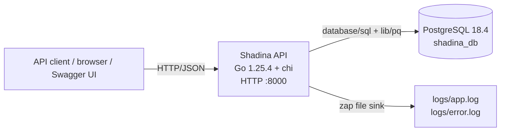
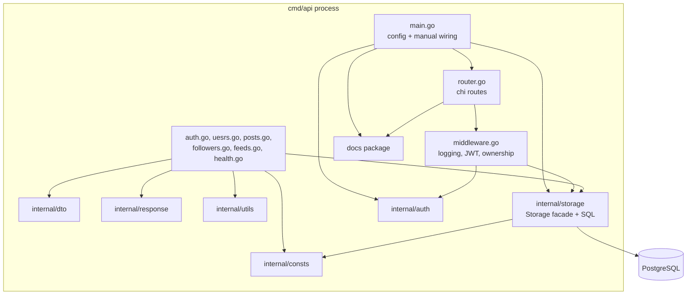
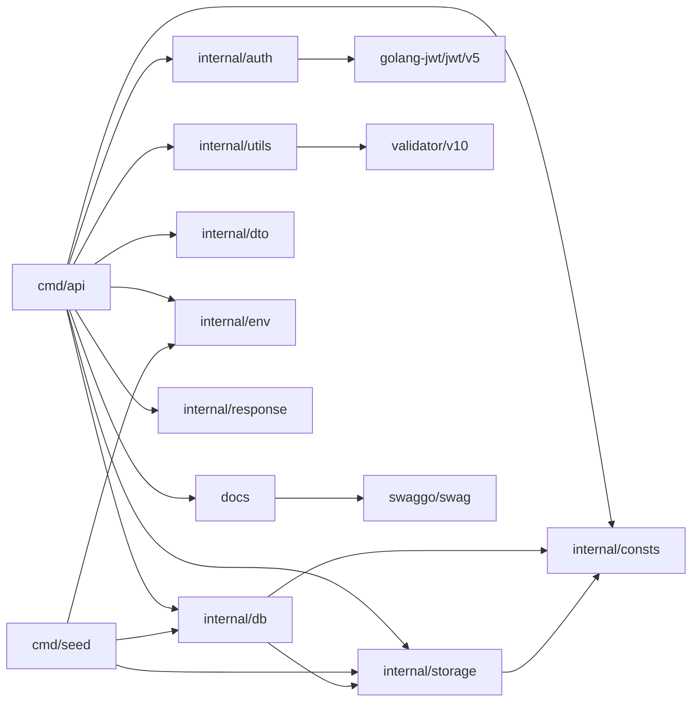
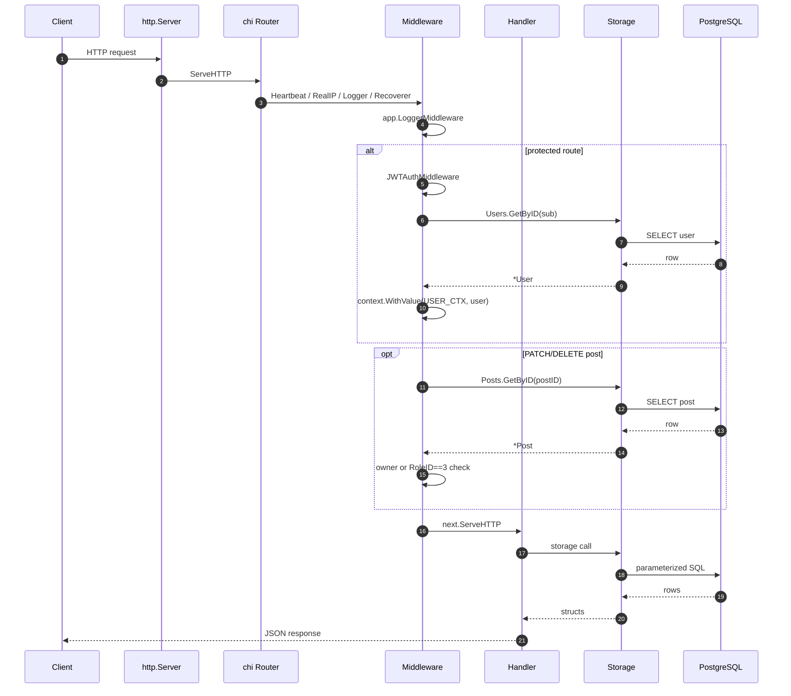

# 02. Architecture

## Architectural style

Shadina is a **layered modular monolith** built around a single Go `net/http` server. The layers are:

1. **Transport and application layer** — `cmd/api`: router, middleware, handlers, configuration wiring.
2. **Request/response types** — `internal/dto`: JSON payload structs and validation tags.
3. **Persistence layer** — `internal/storage`: a `Storage` facade with four storage interfaces and raw SQL.
4. **Supporting packages** — `internal/auth`, `internal/response`, `internal/utils`, `internal/env`,
   `internal/consts`, and the generated `docs` package.
5. **Database** — PostgreSQL, accessed through `database/sql` and `lib/pq`.

There is **no service layer, domain layer, repository-per-entity, unit-of-work, or dependency-injection
framework**. Handlers call storage methods directly. Dependency injection is manual constructor wiring in
`cmd/api/main.go`.

## System context

Source: [system-context.mmd](diagrams/system-context.mmd). No external services are configured.

## Components and responsibilities

Source: [architecture.mmd](diagrams/architecture.mmd).

| Component | Key symbols | Responsibility |
|---|---|---|
| `cmd/api/main.go` | `main`, `config`, `dbConfig`, `authConfig`, `tokenConfig` | Creates loggers, loads `.env`, builds config, opens DB, constructs storage and authenticator, starts server. |
| `cmd/api/api.go` | `application`, `run` | Holds application dependencies and configures `http.Server` (timeouts) and runtime Swagger metadata. |
| `cmd/api/router.go` | `mount` | Builds the chi router, registers middleware and routes, mounts Swagger. |
| `cmd/api/middleware.go` | `LoggerMiddleware`, `JWTAuthMiddleware`, `GetUserCTX`, `UserPostAccessMiddleware` | Request logging, bearer-token authentication, user context, post ownership/role check. |
| `cmd/api/auth.go` | `userRegistrationHandler`, `generateTokenHandler` | Registration and token issuance. |
| `cmd/api/uesrs.go` | `listUsersHandler`, `retrieveUsersHandler` | User read endpoints. |
| `cmd/api/posts.go` | CRUD handlers + `listPostsHandler` | Post CRUD and comment embedding. |
| `cmd/api/followers.go` | `UserFollowHandler`, `UserUnfollowHandler` | Follow/unfollow endpoints. |
| `cmd/api/feeds.go` | `listFeedsHandler` | Feed endpoint and pagination parsing. |
| `cmd/api/health.go` | `healthCheckHandler` | Liveness payload; does not query DB. |
| `internal/auth/auth.go` | `Authenticator` | Interface for token generation/validation. |
| `internal/auth/jwt.go` | `JWTAuthenticator`, `GenerateToken`, `ValidateToken` | HS256 JWT implementation. |
| `internal/storage/storage.go` | `Storage`, `NewPostgresql` | Facade and constructor for four concrete stores. |
| `internal/storage/users.go` | `UsersStorage`, `User`, `HashedPassword`, `ComparePassword` | User SQL + bcrypt helpers. |
| `internal/storage/posts.go` | `PostsStorage`, `Post`, `PostWithMetadata`, `GetFeed` | Post SQL and feed query. |
| `internal/storage/comments.go` | `CommentsStorage`, `Comment` | Comment insert/read SQL. |
| `internal/storage/followers.go` | `FollowersStorage`, `Follower` | Follow/unfollow SQL. |
| `internal/storage/pagination.go` | `PaginatedQuery`, `CreatePaginatedQuery`, `Parse` | Feed query parameters. Note: it lives in the storage package, although it handles HTTP query parsing. |
| `internal/db/db.go` | `NewDB` | Opens `sql.DB`, applies pool settings, pings with 10s timeout. |
| `internal/db/seed.go` | `Seed`, generators | Development seed data; imports `storage`. |
| `internal/dto` | payload structs | JSON request shapes and health response. |
| `internal/env` | `GetString`, `GetInt` | Environment lookup with fallback. |
| `internal/response` | `Response`, `Respond`, helpers | Uniform JSON envelope. |
| `internal/utils` | `ReadJson`, `WriteJson`, `Validate` | 1 MiB body limit, unknown-field rejection, global validator. |
| `internal/consts` | timeouts, `NOT_FOUND`, `USER_CTX` | Shared constants/sentinel. |
| `docs` | `SwaggerInfo` | Generated Swagger template used by `http-swagger`. |
| `cmd/seed` | `main` | Builds DB + storage and calls `db.Seed`. |
| `cmd/migrate/migrations` | SQL files | Versioned schema changes. |

## Package dependency graph

Source: [package-dependency.mmd](diagrams/package-dependency.mmd). The graph is derived from
`go list -f '{{.ImportPath}}|{{join .Imports " "}}' ./...`, not from naming conventions.

**Cycle check:** `go list` and `go build ./...` succeed, and there is no package import cycle. There is,
however, an intentional-looking but questionable dependency: `internal/db` imports `internal/storage`
because `internal/db/seed.go` contains seeding logic. That makes the database-bootstrap package depend on
the persistence package.

## Entry points

| Entry point | Path | What it does |
|---|---|---|
| API server | `cmd/api/main.go` → `main()` | Loads `.env`, builds config, opens DB, constructs `application`, calls `mount()` and `run()`. |
| Seed command | `cmd/seed/main.go` → `main()` | Loads `.env`, opens DB, builds storage, calls `db.Seed`. |
| Migration command | — | There is no Go `main` in `cmd/migrate`; migrations are applied by the external `migrate` CLI from `makefile`. |
| Swagger UI | `cmd/api/router.go` | Serves generated docs at `/v1/swagger/*`. |

## Startup and dependency wiring

`main()` performs the following in order:

1. `init()` sets `utils.Validate = validator.New(validator.WithRequiredStructEnabled())`.
2. Creates `logs/` with mode `0755`; panics on failure.
3. Builds a `zap.NewProductionConfig()` with JSON output to `logs/app.log` and error output to
   `logs/error.log`.
4. Calls `godotenv.Load()`; if `.env` is missing or unreadable, the process exits with
   `error loading .env file`.
5. Reads environment values with defaults and constructs `config`.
6. Calls `db.NewDB(driver, addr, maxOpen, maxIdle, maxIdleTimeout)`; failure calls `log.Fatalln`.
7. Wraps the `*sql.DB` in `storage.NewPostgresql`.
8. Constructs `auth.NewJWTAuthenticator(secret, issuer, audience)`.
9. Constructs `application{config, storage, logger, authenticator}`.
10. Calls `app.mount()` to build the chi handler.
11. Calls `app.run(&mux)`; `run` configures `http.Server` timeouts and calls `ListenAndServe`.

There is no graceful shutdown, signal handling, or `http.Server.Shutdown` call. `log.Fatal` exits the
process, so deferred `log.Sync()` and `db.Close()` are not executed on server termination.

## Request lifecycle

Source: [request-lifecycle.mmd](diagrams/request-lifecycle.mmd). The full middleware order is documented
in [04. Application flow](04-application-flow.md).

## Architectural decisions inferred from the code

| Decision | Evidence | Consequence |
|---|---|---|
| Standard `net/http` + chi rather than a framework | `cmd/api/router.go`, `api.go` | Small dependency surface and explicit middleware order. |
| Manual dependency injection | `cmd/api/main.go` builds every dependency | No container/framework magic; wiring is visible but centralized. |
| Storage facade with anonymous interfaces | `internal/storage/storage.go` | Consumers depend on `storage.Storage`; concrete stores are not independently injectable. |
| Raw SQL, no ORM | `internal/storage/*.go` | Explicit queries and indexes; query correctness/performance is manual. |
| JWT HS256 | `internal/auth/jwt.go` | Stateless tokens, shared secret, no server-side revocation. |
| bcrypt | `internal/storage/users.go` | Password hashes are stored as `bytea`; work factor is `bcrypt.DefaultCost`. |
| Global validator | `internal/utils/validator.go`, `cmd/api/main.go` | Validation is easy to call, but hidden global state and harder test isolation. |
| Generated Swagger + UI handler | `docs/`, `http-swagger` | Swagger is served by the API; generation is currently broken. |
| PostgreSQL migrations as external CLI | `makefile`, `cmd/migrate/migrations` | Schema is versioned; migration execution is not part of the application binary. |
| Compose for PostgreSQL only | `docker-compose.yaml` | Local DB is containerized; the API runs on the host. |

## Coupling and boundary observations

- **Transport ↔ storage:** handlers call `storage.Storage` directly and often encode storage structs as API
  responses. `storage.User`, `storage.Post`, and `storage.Comment` therefore double as API models, which
  couples JSON contracts to SQL row shapes. `internal/dto` contains only request payloads (plus health
  response), not response models.
- **HTTP concerns in storage:** `internal/storage/pagination.go` imports `net/http` and parses query
  parameters. This is an HTTP concern inside the persistence package.
- **Database bootstrap ↔ seed:** `internal/db` imports `internal/storage` for seed logic. A production DB
  package should normally not know about fixture generation.
- **Global validator:** handlers rely on `utils.Validate` being initialized by `main`'s `init`. Tests or
  alternative entry points must initialize it or panic on a nil pointer.
- **Context key:** `GetUserCTX` reads the literal `"user"` while `JWTAuthMiddleware` writes
  `consts.USER_CTX` (also `"user"`). The values match, but the literal is fragile and `staticcheck` flags the
  string key (`SA1029`).
- **Role IDs:** registration hard-codes `RoleID: 1`; authorization hard-codes admin as `RoleID == 3`. These
  depend on seeded role IDs and are not looked up by name.

## Technical debt visible in the architecture

1. No service layer; business decisions (ownership, role checks, feed composition) are split across
   middleware, handlers, and SQL.
2. No typed error model; raw `err.Error()` strings cross the HTTP boundary.
3. No transaction boundary for multi-step operations; post deletion can fail because comments are not
   deleted/cascaded.
4. `listPostsHandler` performs one comment query per post (N+1).
5. Feed SQL has correctness issues (duplicate counts, ignored sort) and the handler does not enforce that
   the path `userID` matches the authenticated user.
6. No graceful shutdown, health DB check, request IDs, metrics, or tracing.
7. No automated tests, mocks, or CI.
8. Swagger generation is blocked by missing DTO types; the checked-in contract is stale.
9. `bin/main` is tracked, `web/` is empty, and `cmd/migrate` lacks a Go entry point.
10. Configuration has a misspelled secret variable (`AUTH_SECRET_KAY`) and a hard-coded fallback secret.

Prioritized remediation is in [Architecture review](../reports/architecture-review.md).

## Related documents

- [Project structure](03-project-structure.md)
- [Application flow](04-application-flow.md)
- [Database design](05-database-design.md)
- [Authentication and authorization](08-authentication-authorization.md)
- [Error handling](10-error-handling.md)
- [Security review](15-security-review.md)
