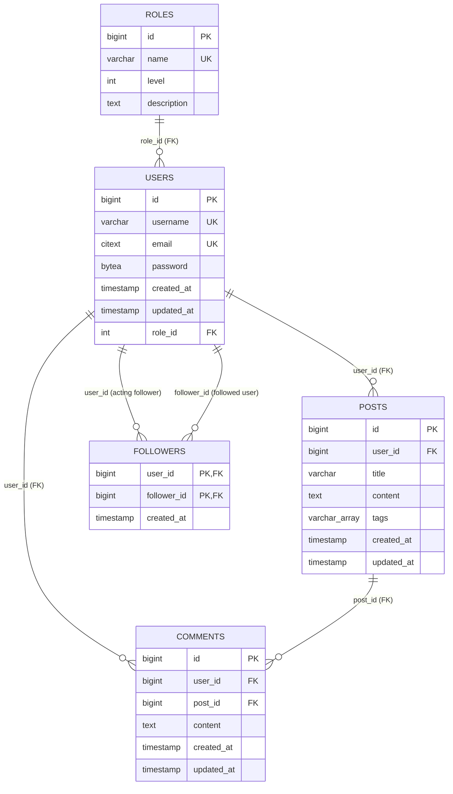

# 05. Database Design

## Overview

Shadina uses PostgreSQL (the Compose image is `postgres:18.4`). The schema is created by the SQL migrations in
`cmd/migrate/migrations` and tracked by golang-migrate's `schema_migrations` table. At review time the local
database reported `version = 12`, `dirty = false`.

Verified extensions: `citext`, `pg_trgm`, `plpgsql`. The `plpgsql` extension is installed by default.

The schema consists of five application tables:

| Table | Purpose |
|---|---|
| `roles` | Named roles and a numeric level. Seeded with `user`, `moderator`, `admin`. |
| `users` | Accounts, bcrypt password hashes, email/username uniqueness, role assignment. |
| `posts` | User-authored posts with title, content, tags, timestamps. |
| `comments` | Comments on posts, authored by users. Read through post responses; no write API. |
| `followers` | Directed follow relationships (composite primary key). |

`schema_migrations` is tool-managed and is not an application table.

## ERD



Source: [database-erd.mmd](diagrams/database-erd.mmd). The diagram uses `timestamp` as a shorthand for
`timestamp(0) with time zone`; the actual SQL type is `timestamp(0) with time zone` (timestamptz with
second precision).

## Table: `roles`

Created by `000011_add_roles_table.up.sql`.

| Column | Type | Nullable | Default | Constraints |
|---|---|---:|---|---|
| `id` | `bigserial` | No | sequence | Primary key |
| `name` | `varchar(255)` | No | — | Unique (`roles_name_key`) |
| `level` | `integer` | No | `0` | — |
| `description` | `text` | Yes | — | — |

Seed rows inserted by the migration:

| id (fresh DB) | name | level | description |
|---:|---|---:|---|
| 1 | `user` | 1 | A user can create posts and comments |
| 2 | `moderator` | 2 | A moderator can update other users posts |
| 3 | `admin` | 3 | An admin can update and delete other users posts |

The IDs are generated by `bigserial` and depend on insertion order on a fresh database. Application code
hard-codes `1` for registration and `3` for admin authorization instead of looking up names.

## Table: `users`

Created by `000001_create_users.up.sql`; altered by `000012_alter_users_with_roles.up.sql`.

| Column | Type | Nullable | Default | Constraints / notes |
|---|---|---:|---|---|
| `id` | `bigserial` | No | sequence | Primary key |
| `username` | `varchar(255)` | No | — | Unique (`users_username_key`) |
| `email` | `citext` | No | — | Unique (`users_email_key`); case-insensitive |
| `password` | `bytea` | No | — | bcrypt hash bytes; never plaintext |
| `created_at` | `timestamp(0) with time zone` | No | `now()` | — |
| `updated_at` | `timestamp(0) with time zone` | No | `now()` | Not automatically updated |
| `role_id` | `integer` | No | — | FK to `roles(id)`; no `ON DELETE` action |

Indexes observed in the live schema:

| Index | Definition | Notes |
|---|---|---|
| `users_pkey` | btree (`id`) | Primary key |
| `users_username_key` | unique btree (`username`) | Enforces uniqueness |
| `users_email_key` | unique btree (`email`) | Enforces citext uniqueness |
| `idx_users_username` | btree (`username`) | Redundant with `users_username_key` |
| `users_role_id_fkey` | — | FK constraint; PostgreSQL does **not** create an index for it automatically |

`password` is scanned into `storage.User.Password` but the field has `json:"-"`, so it is not serialized.
`role_id` is returned by `GetByID`/`GetByEmail`, but `UsersStorage.List` does not select it; list responses
therefore show `role_id: 0` (verified).

## Table: `posts`

Created by `000002_create_posts.up.sql`; FK added by `000003_alter_post_table.up.sql`.

| Column | Type | Nullable | Default | Constraints / notes |
|---|---|---:|---|---|
| `id` | `bigserial` | No | sequence | Primary key |
| `user_id` | `bigint` | No | — | FK `fk_user_post` → `users(id)`; no `ON DELETE` |
| `title` | `varchar(255)` | No | — | — |
| `content` | `text` | No | — | — |
| `tags` | `varchar(255)[]` | Yes | — | PostgreSQL array; GIN-indexed |
| `created_at` | `timestamp(0) with time zone` | No | `now()` | — |
| `updated_at` | `timestamp(0) with time zone` | No | `now()` | Not automatically updated |

Indexes:

| Index | Definition | Used by current code? |
|---|---|---|
| `posts_pkey` | btree (`id`) | Point lookups/updates/deletes |
| `idx_posts_user_id` | btree (`user_id`) | Potentially useful for user posts/feed join |
| `idx_posts_title` | GIN (`title gin_trgm_ops`) | Supports `ILIKE '%search%'` on title in feed |
| `idx_posts_tags` | GIN (`tags`) | No current query filters by tags |

There is no index on `posts.created_at`, although the feed orders by it.

## Table: `comments`

Created by `000004_create_comments.up.sql`; FKs added by `000005_alter_comments_table.up.sql`.

| Column | Type | Nullable | Default | Constraints / notes |
|---|---|---:|---|---|
| `id` | `bigserial` | No | sequence | Primary key |
| `user_id` | `bigint` | No | — | FK `fk_user_comment` → `users(id)`; no `ON DELETE` |
| `post_id` | `bigint` | No | — | FK `fk_post_comment` → `posts(id)`; no `ON DELETE` |
| `content` | `text` | No | — | — |
| `created_at` | `timestamp(0) with time zone` | No | `now()` | — |
| `updated_at` | `timestamp(0) with time zone` | No | `now()` | Not automatically updated |

Indexes:

| Index | Definition | Notes |
|---|---|---|
| `comments_pkey` | btree (`id`) | Primary key |
| `idx_comments_post_id` | btree (`post_id`) | Supports `GetByPostID` |
| `idx_comments_content` | GIN (`content gin_trgm_ops`) | No current query searches comment content |

There is no index on `comments.user_id`; current queries do not filter by it.

## Table: `followers`

Created by `000006_add_followers_table.up.sql`.

| Column | Type | Nullable | Default | Constraints / notes |
|---|---|---:|---|---|
| `user_id` | `bigint` | No | — | FK → `users(id)` `ON DELETE CASCADE`; part of composite PK |
| `follower_id` | `bigint` | No | — | FK → `users(id)` `ON DELETE CASCADE`; part of composite PK |
| `created_at` | `timestamp(0) with time zone` | No | `now()` | — |

Primary key: `(user_id, follower_id)`. This prevents duplicate follows of the same pair.

### Followers and direction

The column names are easy to misread:

- `user_id` — the **acting follower** (the user who follows).
- `follower_id` — the **followed user** (the target).

`FollowersStorage.Follow(ctx, userID, followerID)` is called by the handler as
`Follow(ctx, authenticatedUser.ID, targetUserID)`, so it inserts
`(user_id = authenticated, follower_id = target)`.

The feed query confirms the meaning:

```sql
JOIN followers f ON f.follower_id = p.user_id OR p.user_id = $1
WHERE f.user_id = $1 OR p.user_id = $1
```

A developer who assumes `user_id` is the followed user will write inverted queries. The naming should be
treated as part of the database contract until a migration renames the columns.

## Relationships and referential integrity

| Relationship | Constraint | Enforced by DB? | Delete behavior |
|---|---|---|---|
| `users.role_id → roles.id` | `users_role_id_fkey` | Yes | `NO ACTION` (default); deleting a referenced role fails |
| `posts.user_id → users.id` | `fk_user_post` | Yes | `NO ACTION`; deleting a user with posts fails |
| `comments.user_id → users.id` | `fk_user_comment` | Yes | `NO ACTION`; deleting a user with comments fails |
| `comments.post_id → posts.id` | `fk_post_comment` | Yes | `NO ACTION`; deleting a post with comments fails |
| `followers.user_id → users.id` | `followers_user_id_fkey` | Yes | `ON DELETE CASCADE` |
| `followers.follower_id → users.id` | `followers_follower_id_fkey` | Yes | `ON DELETE CASCADE` |

All relationships are database-enforced. There are no application-only relationships. The lack of
`ON DELETE CASCADE` on posts/comments is observable: deleting a post that has comments raises
`fk_post_comment` and the API returns 500 (verified in a rolled-back transaction).

## Timestamps and time zones

- All timestamps use `timestamp(0) with time zone`; PostgreSQL stores an absolute instant.
- Defaults are `NOW()` at insert.
- `updated_at` is **not** maintained by a trigger or by the SQL `UPDATE` statements. `PostsStorage.Update`
  updates only `title` and `content`, so `updated_at` remains the insertion time.
- Go scans timestamps into `time.Time` and serializes them as RFC3339 strings (for example
  `2026-10-17T07:31:18Z`).
- There is no soft-delete column (`deleted_at`, `is_deleted`); deletes are physical.

## Seed data shape

`internal/db/seed.go` generates:

- 100 users: usernames/emails such as `alice0`, `bob1`, with `RoleID: 1` and **no password**.
- 200 posts: random author, title, content, and two random tags.
- 500 comments: random post, random author, random content.

The seed does not create followers. The local development database at review time contained
`107 users / 203 posts / 500 comments / 4 followers`; the extra users/posts/followers came from manual use
or earlier data, not from the current seed run. Do not infer seed counts from the live row counts.

Seeded users have `password = ''::bytea` (verified: 100 rows). bcrypt comparison against an empty hash fails,
so seeded users cannot obtain tokens. Use `POST /v1/auth/register` to create a login-capable user.

## Schema versus application behavior

| Schema fact | Application behavior |
|---|---|
| `users.role_id` is `NOT NULL` | Registration hard-codes `RoleID: 1`; if role ID 1 is absent, insert fails. |
| `posts.tags` is nullable | `CreatePostPayload.Tags` is optional; nil becomes SQL NULL. |
| `comments.updated_at` exists | `Comment.Create` does not return it, so a freshly created comment struct has zero `UpdatedAt` until re-read. |
| `followers` PK prevents duplicates | `Follow` does not pre-check; duplicate follows return a raw unique-violation error → 500. |
| `comments.post_id` has no cascade | Deleting a post with comments fails → 500. |
| `users.email` is `citext` | Email comparisons/uniqueness are case-insensitive at the DB layer. |

## Related documents

- [Database operations](06-database-operations.md)
- [Database review](../reports/database-review.md)
- [Migration flow diagram](diagrams/migration-flow.mmd)
- [API reference](07-api-reference.md)
