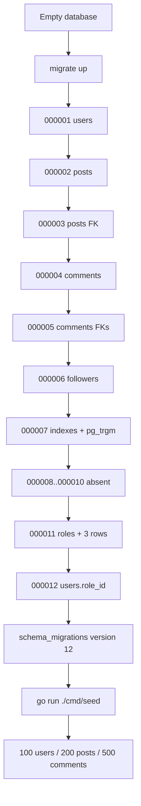

# 06. Database Operations

## Migration mechanism

The project uses the external **golang-migrate** CLI. There is no migration runner inside the API binary and
no `cmd/migrate/main.go`. The makefile points at `./cmd/migrate/migrations` and uses `DATABASE_ADDR` from
`.env` (the makefile does `include .env` and `export`).

At review time:

| Item | Value |
|---|---|
| `migrate` CLI | `4.16.2` |
| Migration path | `./cmd/migrate/migrations` |
| Applied version | `12` |
| Dirty flag | `false` |
| Migration files | 18 SQL files (9 up/down pairs) |
| Missing sequence numbers | `000008`, `000009`, `000010` |

`golang-migrate` creates and maintains `schema_migrations(version bigint primary key, dirty boolean)` in the
target database.

## Migration inventory

| Version | Up migration | Down migration | Notes |
|---:|---|---|---|
| 000001 | Create `citext`; create `users` | Drop `users` | Down does not drop the extension. |
| 000002 | Create `posts` | Drop `posts` | `user_id` has no FK yet. |
| 000003 | Add `fk_user_post` on `posts.user_id` | Drop `fk_user_post` | — |
| 000004 | Create `comments` | Drop `comments` | FKs added separately. |
| 000005 | Add `fk_user_comment`, `fk_post_comment` | Drop both constraints | — |
| 000006 | Create `followers` with composite PK and cascading FKs | Drop `followers` | — |
| 000007 | Create `pg_trgm`; add six indexes | Drop six indexes | Down does not drop `pg_trgm`. |
| 000008–000010 | — | — | Not present. |
| 000011 | Create `roles`; insert `user`, `moderator`, `admin` | Drop `roles` | Inserts have no `ON CONFLICT`. |
| 000012 | Add `users.role_id` with default 1, backfill `user`, drop default, set NOT NULL | Drop `users.role_id` | FK to `roles(id)`. |

The missing 8–10 versions are harmless for golang-migrate (it tracks exact version numbers), but they make
the history look incomplete. There is no migration for seed data or for `schema_migrations`.

## Commands: purpose, prerequisites, effects

All commands below run from the repository root unless stated otherwise. The makefile includes `.env`, so
`make` targets fail if `.env` is missing or syntactically invalid.

| Command | Purpose | Prerequisites | Side effects |
|---|---|---|---|
| `make migrate-up` | Apply all pending migrations | `migrate` CLI; `.env` with `DATABASE_ADDR`; reachable DB | Creates/alters tables and indexes; writes `schema_migrations`. Not destructive on a fresh DB. |
| `make migrate-down 1` | Roll back one migration | Same | **Destructive**: drops/undoes schema objects. Do not run on data you need. |
| `make migrate-down` | Roll back all down migrations (golang-migrate `down` with no limit) | Same | **Destructive**; may drop all tables. |
| `make migrate-force VERSION=n` | Force schema version without running SQL | Same | **Dangerous**: can skip migrations and leave `dirty` state inconsistent. |
| `make migrate-version` | Print current version | `migrate` CLI; DB | Read-only. |
| `make migrate-create NAME=x` | Create a pair of migration files | `migrate` CLI | Creates files only. **Current target is broken**: it does not pass `NAME` to `migrate create`; use the raw command instead. |
| `make seed` | Intended to seed the DB | — | **Broken**: target runs `go run cmd/migrate/seed/main.go`, which does not exist. It does not modify the DB. |
| `go run ./cmd/seed` | Actual seed command | Migrated DB; `.env` | Inserts users/posts/comments; not idempotent; **does not create a transaction boundary**. |
| `make gen-docs` | Regenerate Swagger | `swag`; types referenced by annotations | **Currently fails** at `dto.FollowPayload`; no files are produced in a clean temp run. |

Raw migration examples (equivalent to the make targets):

```bash
migrate -path=./cmd/migrate/migrations -database="$DATABASE_ADDR" up
migrate -path=./cmd/migrate/migrations -database="$DATABASE_ADDR" down 1
migrate -path=./cmd/migrate/migrations -database="$DATABASE_ADDR" version
```

The `make migrate-create` target expands to:

```text
migrate create -seq -ext sql -dir ./cmd/migrate/migrations
```

with no migration name. Use:

```bash
migrate create -seq -ext sql -dir ./cmd/migrate/migrations add_some_change
```

Do not create/run a migration solely to test documentation.

## Migration flow diagram



Source: [migration-flow.mmd](diagrams/migration-flow.mmd).

## Seed operation

`cmd/seed/main.go`:

1. Loads `.env` with `godotenv.Load()`.
2. Reads `DATABASE_ADDR`, pool settings, and `DB_DRIVER` (note: **not** `DATABASE_DRIVER`).
3. Calls `db.NewDB` and `storage.NewPostgresql`.
4. Calls `db.Seed(store, database)`.

`internal/db/seed.go`:

- Generates 100 users, 200 posts, 500 comments.
- Inserts users first, then posts, then comments.
- Returns early on the first insert error.
- Uses `db.BeginTx`, but all storage methods use their own `*sql.DB`, not the transaction object. The
  transaction therefore does **not** wrap the inserts. `tx.Commit()` commits an empty transaction; the
  rollback branch does not undo already-inserted users. `BeginTx` and `Commit` errors are ignored.
- Does not set passwords. Inserted users have an empty `bytea` password and cannot log in.
- Is not idempotent. A second run fails on the first duplicate username/email; users inserted before the
  failure remain. Posts/comments are not attempted after that failure.

Correct command:

```bash
go run ./cmd/seed
```

`make seed` is not usable because it points at `cmd/migrate/seed/main.go`.

## Runtime query inventory

All queries are parameterized (`$1`, `$2`, ...). `pq.Array` is used for `tags`. No query concatenates
untrusted values into SQL.

| Storage method | SQL operation | Parameters | Index/notes |
|---|---|---|---|
| `UsersStorage.Create` | `INSERT INTO users ... RETURNING id, created_at, updated_at` | username, email, bcrypt hash, role_id | Unique indexes enforce duplicates; errors are returned raw. |
| `UsersStorage.List` | `SELECT id, username, email, password, created_at, updated_at FROM users` | none | No `role_id`; no `ORDER BY`; no pagination. |
| `UsersStorage.GetByID` | `SELECT ... role_id ... WHERE id=$1` | id | Primary key; `sql.ErrNoRows` → `consts.NOT_FOUND`. |
| `UsersStorage.GetByEmail` | `SELECT ... WHERE email=$1` | email | `citext` unique index; `sql.ErrNoRows` → `consts.NOT_FOUND`. |
| `PostsStorage.Create` | `INSERT INTO posts ... RETURNING id, created_at, updated_at` | user_id, title, content, tags | `tags` can be NULL. |
| `PostsStorage.List` | `SELECT ... FROM posts` | none | Full table scan; no ordering/pagination. |
| `PostsStorage.GetByID` | `SELECT ... WHERE id=$1` | id | Primary key. |
| `PostsStorage.Delete` | `DELETE FROM posts WHERE id=$1` | id | `RowsAffected()==0` → `NOT_FOUND`; comments FK can block. |
| `PostsStorage.Update` | `UPDATE posts SET title=$1, content=$2 WHERE id=$3` | title, content, id | Does not update `updated_at`; does not inspect rows affected. |
| `PostsStorage.GetFeed` | Complex join/aggregate (see below) | userID, sort, limit, offset, search | Uses `followers`, `comments`, `users`, `posts`; see correctness/performance notes. |
| `CommentsStorage.Create` | `INSERT INTO comments ... RETURNING id, created_at` | user_id, post_id, content | `updated_at` not returned. |
| `CommentsStorage.GetByPostID` | `SELECT ... JOIN users ... WHERE c.post_id=$1 ORDER BY c.created_at DESC` | post_id | Uses `idx_comments_post_id`; joins users by PK. |
| `FollowersStorage.Follow` | `INSERT INTO followers(user_id, follower_id) VALUES ($1,$2)` | authenticated user, target | Duplicate/unknown target → raw DB error. |
| `FollowersStorage.Unfollow` | `DELETE ... WHERE user_id=$1 AND follower_id=$2` | authenticated user, target | Does not check rows affected. |

## Feed query analysis

`PostsStorage.GetFeed` is the most complex query:

```sql
SELECT p.id, p.user_id, p.title, p.content, p.created_at, p.updated_at, p.tags,
       u.username, COUNT(c.id) AS comments_count
FROM posts p
LEFT JOIN comments c ON c.post_id = p.id
LEFT JOIN users u ON p.user_id = u.id
JOIN followers f ON f.follower_id = p.user_id OR p.user_id = $1
WHERE (f.user_id = $1 OR p.user_id = $1)
  AND ($5 = '' OR p.title ILIKE '%' || $5 || '%' OR p.content ILIKE '%' || $5 || '%')
GROUP BY p.id, u.username
ORDER BY p.created_at, $2
LIMIT $3 OFFSET $4
```

Source: [feed-query.mmd](diagrams/feed-query.mmd).

### Verified correctness issues

1. **Comment count inflation.** For the authenticated user's own posts, the `JOIN` condition
   `f.follower_id = p.user_id OR p.user_id = $1` matches every row in `followers` (all follower rows, not
   just the user's), so the `COUNT(c.id)` is multiplied by the number of follower rows. On the local DB,
   post `19` returned `counted = 16` while `COUNT(DISTINCT c.id) = 4`. The API exposes the inflated value.
2. **No own posts if `followers` is empty.** Because the join is an inner `JOIN followers`, a user with no
   rows anywhere in `followers` gets no rows, even for their own posts. The inner join requires at least one
   follower row globally.
3. **Sort direction is ineffective.** `$2` is a parameter, not an identifier; `ORDER BY p.created_at, $2`
   orders by `created_at` and then by a constant value. Local requests with `sort=asc` and `sort=desc`
   returned the same order. `sort` is not injected as SQL (safe from injection) but it does not sort.
4. **Default offset is 10.** `CreatePaginatedQuery(20, 10, "desc")` and no `page` parsing means the first
   page skips 10 rows. Swagger says `page` default 1 and `limit` 20; that is not what the code does.
5. **`since`/`until` are unused.** They are parsed and stored in `PaginatedQuery`, but the SQL never uses
   them. `until` is not even formatted.
6. **Any authenticated user can request any `userID`.** The handler never compares the path ID with the
   authenticated user from context.
7. **Invalid numeric `limit`/`offset` are silently ignored.** `Parse` returns `*pq, nil` on `Atoi` failure,
   leaving the defaults; the caller does not receive an error.
8. **`search` works on title/content only.** `idx_posts_title` helps title search; there is no trigram index
   on `posts.content`, so content search can require a full scan. `idx_comments_content` is unused by this
   query.

### Performance observations

- The `comments` join aggregates all comments per post before pagination; for large data sets this can be
  expensive. A lateral/correlated count or a separate aggregate can be cheaper.
- `ORDER BY p.created_at` has no supporting index.
- `followers` has a composite PK `(user_id, follower_id)`; filtering by `f.user_id` uses the PK prefix, but
  joining on `f.follower_id` alone may not use an index. An index on `(follower_id, user_id)` could help,
  but no benchmark was run.
- `PostsStorage.List` + per-post `GetByPostID` comments is N+1. With 203 posts, that is up to 204 queries.
- `users` list and `posts` list have no pagination; response size grows with the table.

## Transactions

- Request handlers do **not** use explicit transactions.
- Post update/delete are single statements.
- Post deletion with comments is not transactional across `comments` and `posts`; it fails on the FK.
- The only `BeginTx` is in `internal/db/seed.go`, but it does not wrap the storage calls. It is effectively
  a no-op transaction.
- There is no `SERIALIZABLE`/isolation configuration; PostgreSQL defaults apply.

## Connection pool

`internal/db/db.go` calls:

```go
db.SetMaxOpenConns(maxOpenConns)       // default 30
db.SetMaxIdleConns(maxIdleConns)       // default 30
db.SetConnMaxIdleTime(duration)        // default 15m
```

There is no `SetConnMaxLifetime`, no periodic health check, and no per-request connection timeout beyond the
contexts described above. `sql.Open` is lazy; the startup `PingContext` validates connectivity.

## Data integrity risks

| Risk | Evidence | Impact |
|---|---|---|
| Empty password hashes for seeded users | `generateUsers` never sets `Password`; 100 rows with empty bytea | Seeded accounts cannot log in; tests may mislead. |
| Post deletion blocked by comments | FK `fk_post_comment` has no cascade; rolled-back delete failed | `DELETE /v1/posts/{id}` returns 500 for most seeded posts. |
| Duplicate follows return 500 | PK `(user_id, follower_id)` + no pre-check | API contract says 404/400 but returns 500. |
| Unknown follow target returns 500 | FK + no `NOT_FOUND` mapping | Same. |
| Role IDs hard-coded | registration `RoleID: 1`; admin `RoleID == 3` | Fragile if role IDs change. |
| `updated_at` stale | no trigger; update SQL omits it | Clients cannot use `updated_at` for cache invalidation. |
| Feed counts inflated | join duplication | Wrong `comment_count` for own posts. |
| Seed not atomic/idempotent | no-op transaction; early return | Partial data after failures/reruns. |
| Invalid `scripts/init_db.sql` | `CREATE DATABASE IF NOT EXISTS` not PostgreSQL | Script cannot be used as written. |
| Migration gap 8–10 | files absent | Cosmetic/history confusion; no functional issue. |

## Recommendations

**P0 — correctness**

1. Fix the feed query: use `LEFT JOIN`/`EXISTS` for followers, `COUNT(DISTINCT c.id)`, and apply sort
   direction with a whitelisted `CASE`/`ORDER BY` expression (never string concatenation).
2. Decide post deletion semantics: `ON DELETE CASCADE` for comments, or delete comments in a transaction,
   or return a conflict instead of 500.
3. Check `RowsAffected` for unfollow/update and map missing relationships to 404.
4. Set `updated_at = NOW()` in update statements or use a trigger.
5. Fix `UsersStorage.List` to select `role_id`; add ordering/pagination.
6. Replace hard-coded role IDs with lookups by `roles.name`.

**P1 — reliability**

1. Make seed idempotent or explicitly destructive; hash generated passwords or clearly mark accounts
   non-loginable; use a real transaction (`tx` passed to stores).
2. Add `make seed`/`make migrate-create` fixes.
3. Add indexes for feed ordering/join patterns after measuring query plans.
4. Add FK indexes (`users.role_id`, `comments.user_id`) if queries require them.
5. Remove redundant `idx_users_username`.
6. Add migration tests and a CI migration check.

**P2 — performance/maintenance**

1. Add pagination to posts/users.
2. Replace N+1 comment loading with a single aggregate/join or batched query.
3. Remove unused trigram index on `comments.content` or add a comment search feature.
4. Add `updated_at` triggers and audit columns if needed.

## Related documents

- [Database design](05-database-design.md)
- [Database review](../reports/database-review.md)
- [Development guide](13-development-guide.md)
- [Troubleshooting](16-troubleshooting.md)
