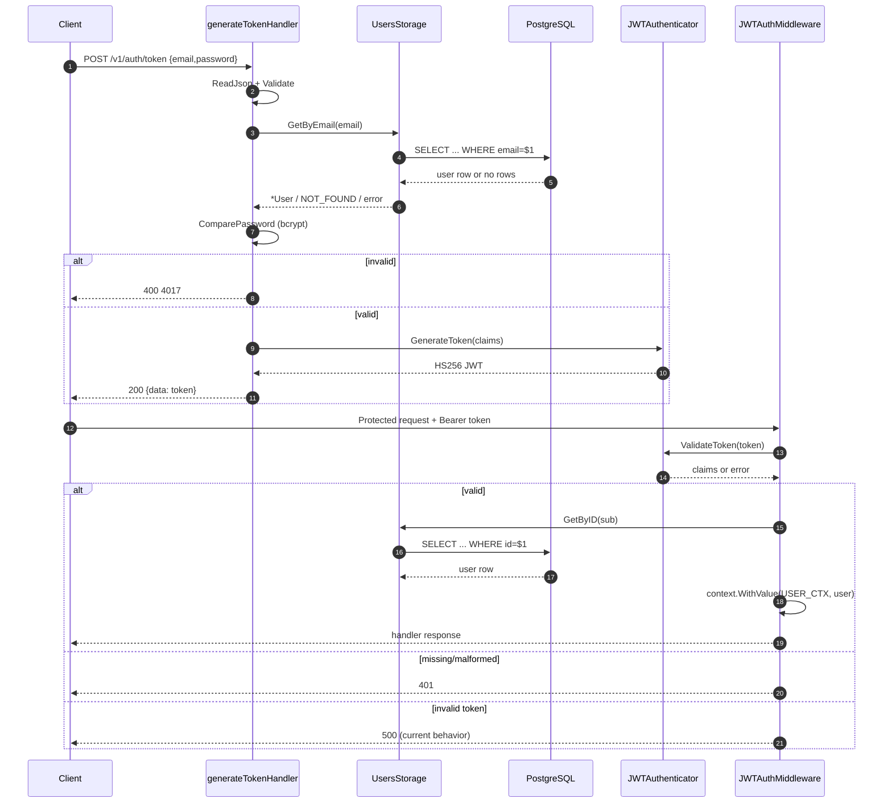

# 08. Authentication and Authorization

## Summary

| Aspect | Implementation |
|---|---|
| Authentication scheme | Bearer JWT in the `Authorization` header |
| Token signing | HMAC-SHA256 (`HS256`) |
| Token issuer/audience | `Shadina` / `Shadina` (hard-coded) |
| Token lifetime | 72 hours (hard-coded `24h * 3`) |
| Claims | `sub`, `exp`, `iat`, `nbf`, `iss`, `aud` |
| Password hashing | bcrypt (`bcrypt.DefaultCost`) |
| Refresh token | **Not implemented** |
| Logout / revocation | **Not implemented** |
| Token storage | Client-side; no server-side session table |
| Roles | Seeded `roles` table; registration hard-codes role 1; admin check hard-codes role 3 |
| Public routes | register, token, health, Swagger, `/ping` |
| Protected routes | all `/v1/users/*` and `/v1/posts/*` |

## Registration and password storage

`POST /v1/auth/register` accepts `dto.UserRegisterPayload`:

```go
type UserRegisterPayload struct {
    Email    string `json:"email" validate:"required,max=255"`
    Username string `json:"username" validate:"required,max=255"`
    Password string `json:"password" validate:"required,min=8,max=255"`
}
```

The handler:

1. Decodes JSON with a 1 MiB limit and `DisallowUnknownFields`.
2. Validates required fields and password length (8–255).
3. Creates `storage.User{Email, Username, RoleID: 1}`.
4. Calls `user.HashedPassword(payload.Password)` → `bcrypt.GenerateFromPassword(..., bcrypt.DefaultCost)`.
5. Inserts the user; the hash is stored in `users.password` (`bytea`).
6. Returns the user with `password` omitted from JSON.

Notable validation gaps:

- No `email` format validator; strings like `not-an-email` pass the struct validator.
- No username character/whitespace rule.
- No duplicate pre-check; unique violations surface as HTTP 500 with raw database text.
- Password length is measured in characters by the validator, while bcrypt has a 72-byte input limit;
  very long passwords can fail hashing and return 500.
- Role ID `1` is assumed to be the `user` role. The migration inserts roles in order, but the code does not
  look up by name.

## Token issuance

`POST /v1/auth/token`:

1. Reads and validates `dto.GenerateTokenPayload`.
2. Loads the user by email (`citext` comparison).
3. Compares the supplied password with the stored bcrypt hash.
4. Builds `jwt.MapClaims`:

```go
claims := jwt.MapClaims{
    "sub": user.ID,
    "exp": time.Now().Add(app.config.auth.token.exp).Unix(),
    "iat": time.Now().Unix(),
    "nbf": time.Now().Unix(),
    "iss": app.config.auth.token.iss, // "Shadina"
    "aud": app.config.auth.token.aud, // "Shadina"
}
```

5. Signs with `jwt.NewWithClaims(jwt.SigningMethodHS256, claims)` and
   `token.SignedString([]byte(secret))`.
6. Returns the token string in `data`.

The secret comes from `AUTH_SECRET_KAY`. The variable name contains a typo (`KAY`, not `KEY`). If it is not
set, the code falls back to a hard-coded development value. There is no startup validation requiring a
strong secret, and `.example.env` does not define either spelling.

`exp` is hard-coded to 72 hours in `cmd/api/main.go`; it is not configurable via environment. There is no
refresh token, sliding expiration, `jti`, device binding, or revocation list. A stolen token remains valid
until expiration unless the signing secret is rotated (which invalidates all tokens).

## Token validation

`JWTAuthMiddleware` (applied to `/v1/users/*` and `/v1/posts/*`):

1. Reads `Authorization`.
2. Requires exactly two space-separated parts and `parts[0] == "Bearer"` (case-sensitive). Multiple spaces
   or lowercase `bearer` are rejected as malformed.
3. Calls `JWTAuthenticator.ValidateToken`:

```go
jwt.Parse(token, keyFunc,
    jwt.WithIssuer("Shadina"),
    jwt.WithAudience("Shadina"),
    jwt.WithExpirationRequired(),
    jwt.WithValidMethods([]string{jwt.SigningMethodHS256.Name}),
)
```

The key function also rejects non-HMAC signing methods. `jwt/v5` validates `nbf` by default. There is no
clock-skew tolerance configuration and no `WithIssuedAt` check.

4. Extracts `claims["sub"]`, formats it with `fmt.Sprintf("%.f", ...)`, and parses it as `int64`.
5. Loads the user by ID from PostgreSQL. The user is fetched on every request, so role changes take effect
   immediately.
6. Stores `*storage.User` in the request context under `consts.USER_CTX` (`"user"`).
7. Calls the next handler.

### Authentication failure behavior

| Condition | HTTP | Internal code | Message |
|---|---:|---:|---|
| No `Authorization` header | 401 | 4019 | `authorization header is missing` |
| Not exactly `Bearer <token>` | 401 | 4020 | `authorization header is malformed` |
| Invalid signature, expired token, wrong issuer/audience, wrong algorithm | **500** | 5019 | raw JWT parser error |
| `sub` missing/unparseable | 401 | 4021 | raw `strconv` error |
| User lookup fails (including DB outage) | 401 | 4022 | raw error text |
| Valid token, handler succeeds | 200 | handler code | — |

Returning 500 for an invalid/expired token is a contract and observability issue: clients may retry, and
monitoring will count authentication failures as server errors. The message can expose parser details.

## Authorization model

### Roles

The `roles` table is seeded with:

| ID (fresh) | Name | Level | Intended description |
|---:|---|---:|---|
| 1 | `user` | 1 | Can create posts and comments |
| 2 | `moderator` | 2 | Can update other users' posts |
| 3 | `admin` | 3 | Can update and delete other users' posts |

There is no role-management API. `JWTAuthMiddleware` does not put roles in the token; it loads `role_id` from
the database on each request.

### Post ownership middleware

`UserPostAccessMiddleware` is applied only to `PATCH` and `DELETE /v1/posts/{postID}`:

```text
load post
if post not found -> 404 (4001)
if user.ID == post.UserID -> continue
if user.RoleID == 3:
    next.ServeHTTP(w, r)      // handler executes
    UnauthorizedResponse(...) // then writes 401 anyway
    return
UnauthorizedResponse("access denied", 4023)
```

Consequences:

- **Owner:** allowed.
- **Admin (`role_id=3`):** the handler executes, but the middleware then attempts to write a 401 after the
  handler's response. In Go's `net/http`, the first `WriteHeader` wins; the second is a no-op (and the second
  JSON body may be appended). The operation may take effect while the response is misleading/corrupted.
  This was verified by code inspection; no admin user existed in the development database to exercise it
  end-to-end.
- **Moderator (`role_id=2`):** denied, despite the role description saying moderators can update other
  users' posts.
- **Other user:** 401 `access denied`, not 403.

### Feed access

`GET /v1/users/{userID}/feeds` requires a valid JWT but does not compare the path `userID` with the
authenticated user. Any authenticated user can read any user's feed. Whether this is intended as a public
timeline is a product decision; the code has no explicit authorization check.

### Follow/unfollow

Any authenticated user can follow or unfollow any other user (including themselves). There is no block list,
approval flow, or role check.

## Authentication sequence



Sources: [authentication-flow.mmd](diagrams/authentication-flow.mmd),
[authorization-flow.mmd](diagrams/authorization-flow.mmd).

## Security observations

| Observation | Evidence | Impact |
|---|---|---|
| Default signing secret | `env.GetString("AUTH_SECRET_KAY", <hard-coded fallback>)`; `.env`/`.example.env` do not define the variable | If the fallback is used in a reachable environment, anyone who knows the source can forge tokens. |
| Misspelled env key | `AUTH_SECRET_KAY` in `cmd/api/main.go` | A correctly named `AUTH_SECRET_KEY` is ignored; operators may believe a secret is configured when it is not. |
| Invalid token → 500 | `JWTAuthMiddleware` calls `InternalErrorResponse` for `ValidateToken` errors | Misclassified auth failures, retry storms, parser-detail leakage. |
| Raw errors to clients | `err.Error()` used in many handlers/middleware | Database/schema/parser details can leak. |
| No token revocation | No `jti`, blacklist, session table, or logout | Stolen tokens valid for 72 hours. |
| No refresh flow | No refresh endpoint or rotation | Poor UX or long-lived tokens; no rotation. |
| No rate limiting/lockout | No middleware for `/auth/token` or `/auth/register` | Online password guessing and registration abuse are unmitigated by the app. |
| No email validation | `validate:"required,max=255"` only | Invalid accounts can be created; duplicate/format issues move to DB/application. |
| User enumeration signals | Not-found vs wrong-password messages/codes differ | An attacker may distinguish existing emails. |
| Admin middleware double-write | `next.ServeHTTP` followed by `UnauthorizedResponse` | Authorization response corruption; admin operations may execute unexpectedly. |
| Feed cross-user access | No path/user comparison | Potential horizontal data exposure depending on product intent. |
| No CORS/TLS/security headers | No CORS middleware; no TLS config | Browser cross-origin clients unsupported; TLS must be terminated elsewhere. |
| Password hashing | bcrypt DefaultCost | Reasonable baseline; cost is not configurable. |

This is a code-review assessment, not a penetration test. No exploitation, fuzzing, dependency vulnerability
scan, or production configuration review was performed. See [Security review](../reports/security-review.md).

## Not implemented

- Refresh tokens, rotation, revocation, logout.
- Password reset/change, email verification.
- MFA.
- Account lockout, rate limiting, CAPTCHA.
- Role management or permission tables beyond `role_id`.
- Token audience per client, scopes, or fine-grained permissions.
- CSRF protection (bearer tokens are not cookie-based, so classic CSRF is less relevant, but no cookie auth
  exists).
- Audit logging of authentication/authorization decisions.

## Recommendations

1. Require `AUTH_SECRET_KAY` (or rename it to `AUTH_SECRET_KEY`) with a strong value and fail startup if it
   is missing/weak.
2. Return 401 for all invalid/expired tokens and avoid echoing parser/DB errors.
3. Fix the admin branch to `return` after `next.ServeHTTP`; define moderator permissions explicitly.
4. Add a route-level check for feed ownership or document it as public.
5. Add rate limiting and login lockout.
6. Validate email format and normalize usernames/emails consistently.
7. Add refresh/rotation/revocation if long-lived sessions are required.
8. Add tests for missing/malformed/expired tokens, owner/admin/other-user access, and duplicate follows.

## Related documents

- [API reference](07-api-reference.md)
- [Configuration](09-configuration.md)
- [Security review](15-security-review.md)
- [Error handling](10-error-handling.md)
