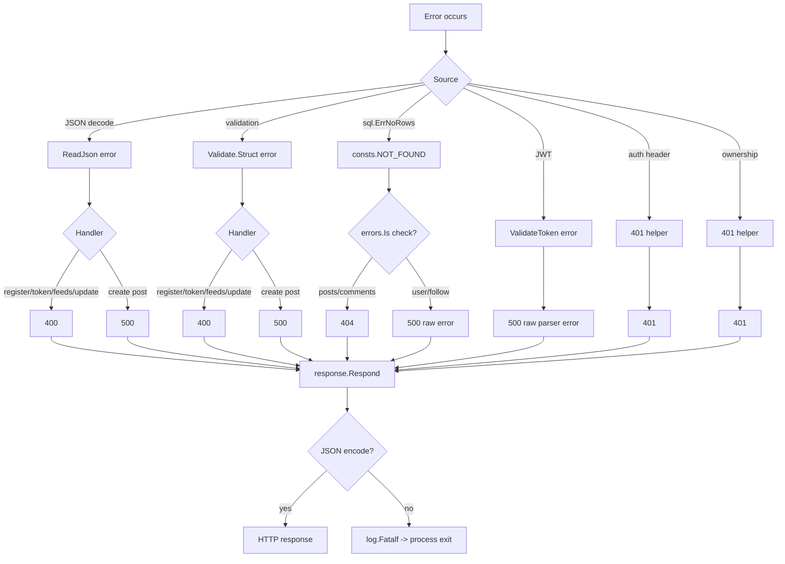

# 10. Error Handling

## Response envelope

All handler responses that use `internal/response` share this shape:

```json
{
  "success": true,
  "message": "human-readable message",
  "internal_code": 1001,
  "data": {}
}
```

| Field | Type | Meaning |
|---|---|---|
| `success` | boolean | `true` for success helpers, `false` for error helpers |
| `message` | string | Human-readable message; may contain raw internal error text |
| `internal_code` | integer | Application code; not an HTTP status |
| `data` | any | Payload on success; always `null` on errors in current helpers |

`internal/response/response.go` implements:

| Helper | HTTP status | `success` |
|---|---:|---|
| `SuccessResponse` | 200 | true |
| `CreatedResponse` | 201 | true (defined but unused) |
| `BadRequestResponse` | 400 | false |
| `UnauthorizedResponse` | 401 | false |
| `ForbiddenResponse` | 403 | false (defined but unused) |
| `NotFoundResponse` | 404 | false |
| `InternalErrorResponse` | 500 | false |

`Respond` sets `Content-Type: application/json`, writes the status, and encodes the envelope. If encoding
fails, it calls `log.Fatalf`, which terminates the process; the following `http.Error` is unreachable. With
the current data types this is unlikely, but it is an availability risk.

Some responses bypass the envelope:

- `GET /v1/health` writes `dto.HealthStatusPayload` directly via `utils.WriteJson`.
- `/ping` returns `text/plain` `.`.
- chi's default 404/405 responses are plain text.
- Swagger assets are HTML/JS/JSON.

## Internal code registry

### Success codes

| Code | Message | Used by |
|---:|---|---|
| 1001 | posts retrieved successfully | `GET /v1/posts` |
| 1002 | post created successfully | `POST /v1/posts` |
| 1003 | post retrieved successfully | `GET /v1/posts/{postID}` |
| 1004 | post deleted successfully / post updated successfully | `DELETE` and `PATCH /v1/posts/{postID}` (collision) |
| 1005 | users retrieved successfully | `GET /v1/users` |
| 1006 | user retrieved successfully | `GET /v1/users/{userID}` |
| 1007 | user followed successfully | `PUT .../follow` |
| 1008 | user unfollowed successfully | `PUT .../unfollow` |
| 1009 | feeds retrieved successfully | `GET .../feeds` |
| 1010 | user registered successfully | `POST /v1/auth/register` |
| 1011 | generate token successfully | `POST /v1/auth/token` |

### Error codes

| Code | HTTP | Message source | Used by |
|---:|---:|---|---|
| 4001 | 404 | `post not found` | post retrieve/delete/update access |
| 4002 | 404 | `not found` | update handler, post fetch |
| 4003 | 400 | `request invalid` | update JSON decode |
| 4004 | 400 | `request invalid` | update validation |
| 4006 | 404 | `not found` | follow branch; **unreachable** (storage returns raw DB errors) |
| 4008 | 404 | `not found` | unfollow branch; **unreachable** (RowsAffected not checked) |
| 4009 | 400 | — | feed pagination parse; **unreachable** (`Parse` always returns `nil`; invalid numbers are ignored) |
| 4010 | 400 | `err.Error()` | feed pagination validation |
| 4011 | 400 | `invalid request` | register JSON decode |
| 4012 | 400 | `err.Error()` | register validation |
| 4013 | 400 | `invalid request` | token JSON decode |
| 4014 | 400 | `invalid request` | token validation |
| 4015 | 400 | `invalid request` | token user not found |
| 4016 | 400 | `invalid request` | token DB error |
| 4017 | 400 | `invalid email or password` | wrong password |
| 4018 | 400 | `invalid request` | token signing error |
| 4019 | 401 | `authorization header is missing` | JWT middleware |
| 4020 | 401 | `authorization header is malformed` | JWT middleware |
| 4021 | 401 | `err.Error()` | `sub` parse failure |
| 4022 | 401 | `err.Error()` | user lookup failure after token |
| 4023 | 401 | `access denied` | post ownership |
| 5001 | 500 | `err.Error()` | posts list |
| 5002 | 500 | `err.Error()` | create post JSON |
| 5003 | 500 | `err.Error()` | create post DB |
| 5004 | 500 | `err.Error()` | post ID parse (retrieve/middleware) |
| 5005 | 500 | `err.Error()` | post fetch (retrieve/middleware) |
| 5006 | 500 | `err.Error()` | create post validation |
| 5007 | 500 | `err.Error()` | post ID parse (delete/update) |
| 5008 | 500 | `err.Error()` | delete/update DB |
| 5009 | 500 | `err.Error()` | comments fetch; also users list |
| 5010 | 500 | `err.Error()` | user ID parse/user retrieve |
| 5013 | 500 | `err.Error()` | follow DB |
| 5015 | 500 | `err.Error()` | unfollow DB |
| 5016 | 500 | `err.Error()` | feed path ID parse |
| 5017 | 500 | `err.Error()` | feed DB |
| 5018 | 500 | `failed to hash password` or `err.Error()` | register hash/DB (collision) |
| 5019 | 500 | `err.Error()` | JWT validation |
| 5020 | 500 | `err.Error()` | follow path ID parse |
| 5021 | 500 | `err.Error()` | unfollow path ID parse |

Unused/gaps: 4005, 4007, 5011, 5012, 5014, and any codes above 5021 are not used. Codes are manually
assigned and collide (1004, 5004, 5005, 5008, 5009, 5010, 5018). There is no central code registry or
machine-readable error catalog.

## Error mapping flow



Source: [error-handling.mmd](diagrams/error-handling.mmd).

## Inconsistencies

1. **Validation is sometimes 400, sometimes 500.** Registration/token/feed/update use 400; create post uses
   500 (`5006`). The Swagger contract says 400 for create post.
2. **Not found is sometimes 404, sometimes 500.** Posts/comments map `consts.NOT_FOUND`; users/follow do not.
   `GET /v1/users/999999` returns 500 code `5010`.
3. **Invalid token is 500, not 401.** `JWTAuthMiddleware` uses `InternalErrorResponse` for parser errors.
4. **Raw internal errors are returned.** Examples verified locally:
   - invalid token: `"token is malformed: token contains an invalid number of segments"` (500/5019)
   - non-numeric user ID: `"strconv.ParseInt: parsing \"abc\": invalid syntax"` (500/5010)
   - missing user: `"not found"` (500/5010)
   - create post empty body: `"EOF"` (500/5002)
   - validation messages include struct/field names.
5. **Database errors can leak schema details.** `err.Error()` from `lib/pq` may include constraint names,
   table/column names, and values in some errors.
6. **Dead 404 branches.** Follow/unfollow declare 404 codes but storage never returns `consts.NOT_FOUND`.
7. **Unfollow reports success for no-op.** `RowsAffected` is ignored.
8. **401 vs 403.** Ownership failures return 401, not 403.
9. **Default chi errors are not enveloped.** A 404/405 can break clients expecting JSON.
10. **`log.Fatalf` on encode failure** can terminate the server instead of returning a 500.

## Examples

### Successful response

```json
{"success":true,"message":"post retrieved successfully","internal_code":1003,"data":{...}}
```

### Validation error (registration)

```json
{
  "success": false,
  "message": "Key: 'UserRegisterPayload.Username' Error:Field validation for 'Username' failed on the 'required' tag",
  "internal_code": 4012,
  "data": null
}
```

### Authentication error (missing header)

```json
{"success":false,"message":"authorization header is missing","internal_code":4019,"data":null}
```

### Invalid token (current behavior)

```json
{
  "success": false,
  "message": "token is malformed: token contains an invalid number of segments",
  "internal_code": 5019,
  "data": null
}
```

### Not found (current behavior for users)

```json
{"success":false,"message":"not found","internal_code":5010,"data":null}
```

## Recommendations

1. Introduce typed application errors (validation, unauthorized, forbidden, not found, conflict, internal)
   and a single HTTP mapper.
2. Return 401 for invalid/expired tokens; return 403 for authenticated-but-forbidden actions.
3. Log the full internal error with a request ID; return a generic message plus a correlation ID to clients.
4. Use 400 for all input/validation failures (including create post) and 201 for creations, or update
   Swagger to match the chosen contract.
5. Replace `log.Fatalf` in `Respond` with a logged 500 response.
6. Use `errors.Is` consistently and return `consts.NOT_FOUND` from storage/follow operations where the
   handler advertises 404.
7. Add JSON 404/405 handlers.
8. Add a central error-code registry with non-overlapping codes and tests.

## Related documents

- [API reference](07-api-reference.md)
- [Authentication and authorization](08-authentication-authorization.md)
- [Logging and observability](11-logging-observability.md)
- [Security review](../reports/security-review.md)
