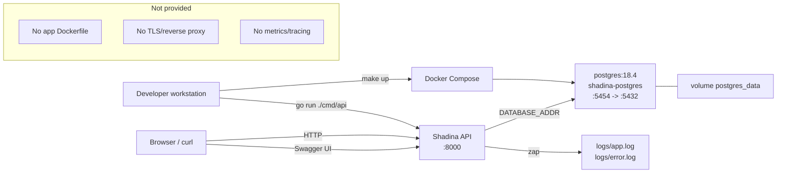

# 12. Docker and Deployment

## What Docker Compose actually runs

`docker-compose.yaml` defines **only PostgreSQL**:

```yaml
services:
  postgresql:
    container_name: shadina-postgres
    image: postgres:18.4
    restart: always
    environment:
      POSTGRES_USER: user
      POSTGRES_PASSWORD: password
      POSTGRES_DB: shadina_db
    ports:
      - "5454:5432"
    volumes:
      - postgres_data:/var/lib/postgresql

volumes:
  postgres_data:
```

| Property | Value |
|---|---|
| Container name | `shadina-postgres` |
| Image | `postgres:18.4` |
| Host port | `5454` → container `5432` |
| Database | `shadina_db` |
| Development user/password | Defined inline in the Compose file; do not reuse outside local development |
| Volume | `postgres_data` mounted at `/var/lib/postgresql` |
| Restart policy | `always` |
| Healthcheck | **None** |
| Application service | **None** |
| Dockerfile | **None in the repository** |
| Migration/seed job | **None** |

The API runs as a host process (`go run ./cmd/api`), not in Compose. `make up` therefore starts only the
database.

## Deployment diagram



Source: [deployment.mmd](diagrams/deployment.mmd).

## Supported local deployment

### Prerequisites

- Go 1.25.4 (from `go.mod`).
- Docker + Docker Compose.
- `migrate` CLI (golang-migrate) for migrations.
- `swag` only if you need to regenerate Swagger (currently blocked).
- A `.env` file (copy `.example.env` and edit; see [Configuration](09-configuration.md)).

### Steps

```bash
# 1. Inspect the existing environment file before overwriting anything
ls -l .env .example.env

# 2. Create .env if it does not exist, then edit values
cp .example.env .env
# Add SERVER_URL and AUTH_SECRET_KAY; ensure DATABASE_ADDR uses port 5454/shadina_db.

# 3. Start PostgreSQL
docker compose up -d        # or: make up-back (foreground: make up)

# 4. Apply migrations (requires the migrate CLI)
make migrate-up

# 5. Seed development data (the make target is broken; use the real command)
go run ./cmd/seed

# 6. Run the API
go run ./cmd/api

# 7. Verify liveness (does not check DB)
curl -sS http://127.0.0.1:8000/v1/health
curl -sS http://127.0.0.1:8000/ping
```

Do not run step 5 on a database containing data you need: the seed is not idempotent and inserts fixtures.
Do not overwrite an existing `.env` without reviewing it.

### Expected startup behavior

- The API creates `logs/` and writes startup lines to `logs/app.log`.
- It pings PostgreSQL at startup; failure exits immediately.
- The server listens on `SERVER_ADDR` (default `:8000`).
- `make up`/`docker compose up` starts PostgreSQL only; the API is a separate process.

## Build

```bash
# Build the API to a temporary path (does not overwrite the tracked bin/main)
go build -o /tmp/shadina-api ./cmd/api

# Build all packages (cmd/migrate is skipped because it has no Go files)
go build ./...

# Optional: build the seed binary
go build -o /tmp/shadina-seed ./cmd/seed
```

`go build ./cmd/migrate` fails with `no Go files in .../cmd/migrate`; migrations are applied by the external
CLI. `bin/main` is a tracked 27 MB binary and may be stale; prefer a fresh build.

## Make targets

| Target | What it does | Data impact |
|---|---|---|
| `make help` | Prints the target list | None, but `.env` must exist because the makefile includes it. |
| `make up` | `docker compose up --build` (foreground; PostgreSQL only) | Starts/updates the DB container; volume preserved. |
| `make up-back` | `docker compose up --build -d` | Same, detached. |
| `make down` | `docker compose down` | Stops/removes containers and the default network; named volume is preserved. |
| `make build` | `docker compose build` | Builds Compose images; only PostgreSQL has an image, so no app image is built. |
| `make logs` | `docker compose logs -f` | Read-only; DB logs only. |
| `make restart` | `docker compose down && docker compose up --build` | Recreates containers; named volume preserved. |
| `make migrate-up` | golang-migrate up | Schema changes; writes `schema_migrations`. |
| `make migrate-down 1` | golang-migrate down 1 | **Destructive** schema rollback. |
| `make migrate-force VERSION=n` | golang-migrate force | **Dangerous**; can desynchronize schema/version. |
| `make seed` | Broken path `cmd/migrate/seed/main.go` | Fails; no DB changes. |
| `go run ./cmd/seed` | Real seed | Inserts fixtures; not idempotent. |
| `make test` | `go test -v ./...` | No test files; exits 0. |
| `make lint` | `gofmt -s -w .` then `golangci-lint run ./...` | **Modifies source formatting**, then reports 12 lint issues. |
| `make format` | `gofmt -s -w .` | Modifies source formatting. |
| `make gen-docs` | `swag init ...` | **Currently fails** at missing `dto.FollowPayload`; do not assume docs regenerate. |

### Destructive commands to avoid without explicit approval

- `docker compose down -v` / `docker volume rm shadina_postgres_data`: deletes the database volume.
- `migrate down` (without a limit) / `make migrate-down`: drops schema objects.
- `migrate force`: can mark a version without applying SQL.
- `TRUNCATE`, `DROP TABLE`, or manual `DELETE` on the development DB.

## Production deployment gaps

The repository does not provide a production deployment. Missing pieces include:

- An application Dockerfile and image (multi-stage build, non-root user, healthcheck).
- A process manager/systemd unit or Kubernetes manifests.
- Migration and seed jobs as part of deployment.
- A reverse proxy/TLS terminator (nginx, Traefik, Caddy, cloud LB).
- CORS policy for browser clients.
- Secrets injection/rotation (vault/KMS/secret manager).
- Graceful shutdown and readiness probes.
- Log aggregation, rotation, metrics, tracing, alerting.
- Backups, point-in-time recovery, and restore drills.
- Resource limits, autoscaling, and network policies.
- Dependency/container vulnerability scanning and SBOM.
- A migration rollback/runbook and release checklist.

`docker-compose.yaml` is a **development database**, not a production topology. The inline development
credentials must not be reused.

## Deployment verification performed

| Check | Result |
|---|---|
| `docker compose config` parses | Passed; one service (`postgresql`), one volume. |
| PostgreSQL container running | Yes (`shadina-postgres`, `postgres:18.4`, host port 5454) during review. |
| API build | `go build ./...` passed; `./cmd/migrate` has no Go files. |
| API started locally | Yes, temporary binary; health/swagger/auth checks performed. |
| Production deployment | Not performed; no manifests/credentials. |
| Container image build for API | Not possible; no Dockerfile. |

## Related documents

- [Configuration](09-configuration.md)
- [Development guide](13-development-guide.md)
- [Database operations](06-database-operations.md)
- [Troubleshooting](16-troubleshooting.md)
