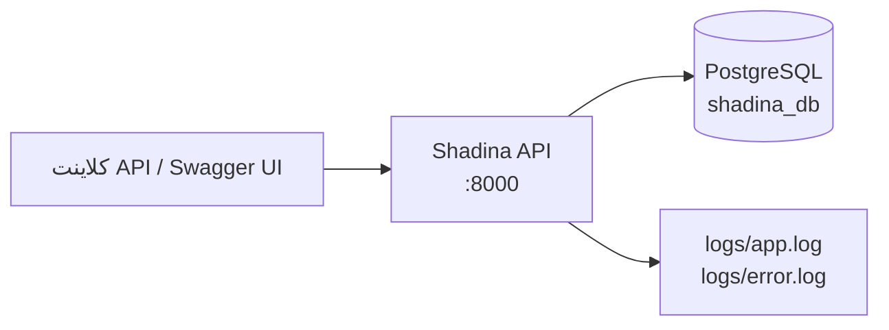

# 01. مرور پروژه

## هدف و دامنه

شادینا یک **بک‌اند شبکه اجتماعی** کوچک است که با زبان Go نوشته شده است. این سرویس JSON را روی HTTP برای
ثبت‌نام حساب، ورود/صدور توکن، جست‌وجوی کاربر، دنبال‌کردن/دنبال‌نکردن، فید شخصی‌سازی‌شده و مدیریت پایه پست‌ها
ارائه می‌کند. پست‌ها می‌توانند برچسب و نظر داشته باشند؛ API فعلی **خواندن** نظرها را از طریق پاسخ پست‌ها فراهم
می‌کند اما ساخت، ویرایش یا حذف نظر را ارائه نمی‌دهد.

این مخزن یک پروژه صرفاً بک‌اند است:

- `cmd/api` سرور HTTP است.
- `cmd/seed` داده‌های توسعه را درج می‌کند.
- `cmd/migrate/migrations` شامل مهاجرت‌های SQL نسخه‌بندی‌شده است، اما `cmd/migrate` **هیچ نقطه ورود Go ندارد**.
- `web/` خالی است. هیچ فرانت‌اند، سایت استاتیک یا رابط کاربری رندر‌شده در سرور وجود ندارد.
- Swagger UI توسط خود API ارائه می‌شود، نه یک سرویس مستندات جداگانه.

بهترین توصیف سیستم یک **مونولیت ماژولار لایه‌ای** است: لایه انتقال HTTP و میان‌افزار در `cmd/api`، انواع
درخواست/پاسخ در `internal/dto`، SQL و ماندگاری در `internal/storage` و ابزارهای پشتیبان در بسته‌های کوچک‌تر.
هیچ لایه سرویس/دامنه جداگانه‌ای وجود ندارد؛ هندلرها مستقیماً فراخوانی‌های storage را هماهنگ می‌کنند.

## قابلیت‌های تأییدشده

| قابلیت | API | وضعیت | یادداشت |
|---|---|---|---|
| ثبت‌نام کاربر | `POST /v1/auth/register` | پیاده‌سازی شده | عمومی. HTTP 200 برمی‌گرداند، نه 201. نقش به `role_id = 1` ثابت شده است. |
| صدور JWT | `POST /v1/auth/token` | پیاده‌سازی شده | ورود با ایمیل/رمز عبور. HS256، انقضای ۷۲ ساعته. بدون refresh token. |
| سلامت/زنده‌بودن | `GET /v1/health` | پیاده‌سازی شده | همیشه `ok` گزارش می‌کند؛ دیتابیس را بررسی نمی‌کند. |
| ضربان | `GET /ping` | پیاده‌سازی شده | میان‌افزار `Heartbeat` در chi؛ بدنه `.` است (نه `pong`). |
| فهرست کاربران | `GET /v1/users` | پیاده‌سازی شده | JWT لازم است. بدون صفحه‌بندی. `role_id` به‌صورت `0` برمی‌گردد چون کوئری آن را حذف کرده است. |
| دریافت کاربر | `GET /v1/users/{userID}` | پیاده‌سازی شده | JWT لازم است. حالت‌های یافت‌نشدن و شناسه نامعتبر HTTP 500 برمی‌گردانند. |
| دنبال‌کردن کاربر | `PUT /v1/users/{userID}/follow` | پیاده‌سازی شده | JWT لازم است. هیچ بدنه درخواستی خوانده نمی‌شود. هدف تکراری/ناشناخته HTTP 500 تولید می‌کند. |
| دنبال‌نکردن کاربر | `PUT /v1/users/{userID}/unfollow` | پیاده‌سازی شده | JWT لازم است. رابطه ناموجود همچنان موفقیت برمی‌گرداند. |
| فید شخصی | `GET /v1/users/{userID}/feeds` | پیاده‌سازی شده | JWT لازم است. هر کاربر احراز هویت‌شده می‌تواند فید هر `userID` را درخواست کند. |
| فهرست پست‌ها | `GET /v1/posts` | پیاده‌سازی شده | JWT لازم است. همه پست‌ها و نظرها را برمی‌گرداند؛ بدون صفحه‌بندی؛ N+1 کوئری نظر. |
| ساخت پست | `POST /v1/posts` | پیاده‌سازی شده | JWT لازم است. HTTP 200 برمی‌گرداند، هرچند Swagger می‌گوید 201. |
| دریافت پست | `GET /v1/posts/{postID}` | پیاده‌سازی شده | JWT لازم است. شامل نظرها. |
| ویرایش پست | `PATCH /v1/posts/{postID}` | پیاده‌سازی شده | مسیر مالک یا ادمین. مسیر ادمین باگ نوشتن پاسخ دارد. |
| حذف پست | `DELETE /v1/posts/{postID}` | پیاده‌سازی شده | مسیر مالک یا ادمین. پست‌های دارای نظر روی کلید خارجی شکست می‌خورند. |
| Swagger UI | `GET /v1/swagger/*` | پیاده‌سازی شده | عمومی؛ آدرس spec آن اشتباه پیکربندی شده است. |
| خواندن نظرها | جاسازی‌شده در پاسخ پست | پیاده‌سازی شده | هیچ endpoint مستقل نظر وجود ندارد. |
| ساخت نظر | — | پیاده‌سازی نشده | `CommentsStorage.Create` وجود دارد اما هیچ مسیری آن را صدا نمی‌زند؛ فقط seed از آن استفاده می‌کند. |
| تازه‌سازی/خروج/ابطال توکن | — | پیاده‌سازی نشده | بدون endpoint، بدون blacklist توکن، بدون refresh token. |
| بازنشانی/تغییر رمز | — | پیاده‌سازی نشده | — |
| ویرایش/حذف کاربر | — | پیاده‌سازی نشده | — |
| مدیریت نقش‌ها | — | پیاده‌سازی نشده | نقش‌ها با مهاجرت seed می‌شوند؛ بدون CRUD. |
| صفحه‌بندی کاربران/پست‌ها | — | پیاده‌سازی نشده | فقط فید پارامترهای صفحه‌بندی می‌پذیرد. |
| متریک/ردیابی/پروفایلینگ | — | پیاده‌سازی نشده | بدون Prometheus، OpenTelemetry، pprof یا request ID. |
| تست خودکار | — | پیاده‌سازی نشده | هیچ فایل `*_test.go` وجود ندارد. |
| کانتینر برنامه | — | پیاده‌سازی نشده | Compose فقط PostgreSQL را اجرا می‌کند؛ هیچ Dockerfile وجود ندارد. |
| CI/CD | — | پیاده‌سازی نشده | هیچ پیکربندی CI یافت نشد. |

## پشته فناوری

نسخه‌های زیر از `go.mod`، `go.sum`، `docker-compose.yaml` و زنجیره ابزار نصب‌شده در زمان بررسی گرفته شده‌اند.

| مؤلفه | نسخه / منبع | نقش |
|---|---|---|
| Go | `go 1.25.4` در `go.mod`؛ نسخه نصب‌شده `go1.25.4` | زبان/زمان اجرا |
| chi | `github.com/go-chi/chi/v5 v5.2.5` | روتر و میان‌افزار HTTP |
| PostgreSQL | ایمیج `postgres:18.4` در Compose | دیتابیس |
| `lib/pq` | `v1.12.3` | درایور PostgreSQL |
| `go-playground/validator` | `v10.30.4` | اعتبارسنجی درخواست/صفحه‌بندی |
| `golang-jwt/jwt/v5` | `v5.3.1` | امضا و اعتبارسنجی JWT |
| `golang-jwt/jwt` (نسخه ۳) | `v3.2.2+incompatible` | اعلام‌شده اما استفاده‌نشده؛ `go mod why` می‌گوید لازم نیست |
| `golang.org/x/crypto` | `v0.55.0` | هش رمز عبور با bcrypt |
| `go.uber.org/zap` | `v1.28.0` | لاگ‌نویسی ساخت‌یافته در فایل |
| `swaggo/swag` | `v1.16.6` (ماژول)، CLI `v1.16.4` در زمان بررسی | تولید Swagger |
| `swaggo/http-swagger/v2` | `v2.0.2` | هندلر Swagger UI |
| `joho/godotenv` | `v1.5.1` | بارگذاری `.env` |
| Docker Compose | فرمت Compose بدون `version` سطح بالا؛ Compose v5.5.1 در زمان بررسی | PostgreSQL محلی |
| golang-migrate CLI | `4.16.2` در زمان بررسی | اعمال مهاجرت‌ها |
| golangci-lint | `2.15.0` در زمان بررسی | لینت اختیاری |

## توپولوژی زمان اجرا

تنها وابستگی‌های زمان اجرا فرآیند API، PostgreSQL و فایل‌سیستم محلی برای لاگ‌ها هستند.

هیچ ارائه‌دهنده هویت خارجی، کارگزار پیام، کش، ذخیره‌ساز شیء، سرویس ایمیل یا API شخص ثالثی در کد وجود ندارد.
به [زمینه سیستم](diagrams/system-context.mmd) مراجعه کنید.

## نقشه مخزن

| مسیر | مسئولیت |
|---|---|
| `cmd/api` | سرور HTTP، مسیرها، هندلرها، میان‌افزار، سیم‌کشی برنامه |
| `cmd/seed` | seed داده توسعه |
| `cmd/migrate/migrations` | مهاجرت‌های SQL (پوشه هیچ `main.go` ندارد) |
| `internal/auth` | رابط `Authenticator` و پیاده‌سازی HS256 JWT |
| `internal/consts` | تایم‌اوت‌ها، `NOT_FOUND`، کلید context |
| `internal/db` | راه‌اندازی اتصال دیتابیس و تولید داده seed |
| `internal/dto` | payloadهای درخواست و payload سلامت |
| `internal/env` | کمک‌تابع‌های محیطی رشته/عدد |
| `internal/response` | پاکت پاسخ JSON و کمک‌تابع‌ها |
| `internal/storage` | نمای storage، کوئری‌های SQL، متدهای bcrypt، صفحه‌بندی |
| `internal/utils` | کمک‌تابع‌های خواندن/نوشتن JSON و validator سراسری |
| `docs` | قالب تولیدشده Swagger، JSON و YAML |
| `scripts/init_db.sql` | اسکریپت تلاش‌شده راه‌اندازی DB؛ توسط Compose استفاده نمی‌شود و در شکل نوشته‌شده PostgreSQL معتبر نیست |
| `web` | پوشه خالی؛ بدون برنامه وب |
| `logs` | خروجی لاگ زمان اجرا؛ توسط Git نادیده گرفته می‌شود |
| `bin/main` | باینری کامپایل‌شده ردیابی‌شده؛ بخشی از build منبع نیست |

حاشیه‌نویسی تفصیلی در [03. ساختار پروژه](03-project-structure.md) آمده است.

## آنچه توسعه‌دهنده جدید باید ابتدا بداند

1. API از `cmd/api/main.go` شروع می‌شود؛ پیکربندی از `.env` در پوشه کاری جاری خوانده می‌شود.
2. مسیرهای محافظت‌شده به `Authorization: Bearer <JWT>` نیاز دارند؛ JWT توسط `POST /v1/auth/token` صادر می‌شود.
3. دیتابیس PostgreSQL است؛ مهاجرت‌ها را با `make migrate-up` اعمال و داده توسعه را با
   `go run ./cmd/seed` ایجاد کنید (هدف `make seed` شکسته است).
4. کاربران seed‌شده **هش رمز خالی** دارند و نمی‌توانند وارد شوند. برای آزمایش احراز هویت کاربر جدید ثبت‌نام کنید.
5. Swagger اکنون کهنه است و `make gen-docs` شکست می‌خورد چون دو DTO حاشیه‌نویسی‌شده وجود ندارند.
6. هیچ تستی وجود ندارد؛ موفقیت build/vet تضمین عملکردی نیست.

## اسناد مرتبط

- [معماری](02-architecture.md)
- [جریان برنامه](04-application-flow.md)
- [طراحی دیتابیس](05-database-design.md)
- [مرجع API](07-api-reference.md)
- [پیکربندی](09-configuration.md)
- [تست و کیفیت](14-testing-quality.md)
- [مرور امنیتی](15-security-review.md)
