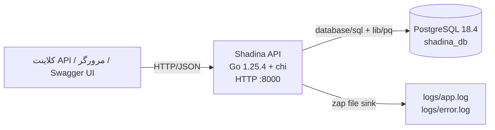
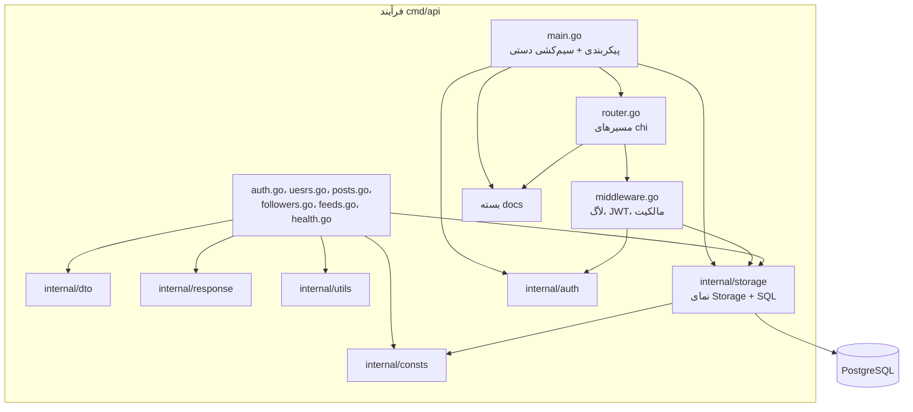
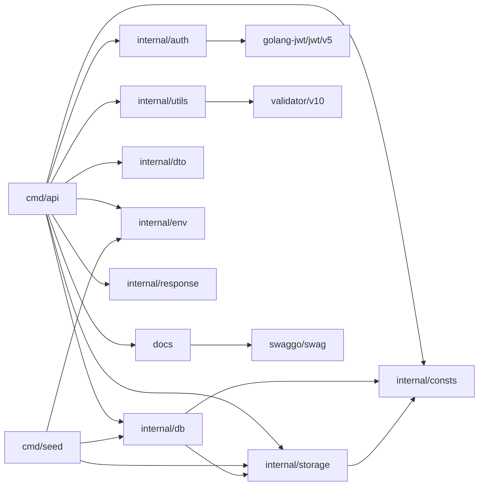
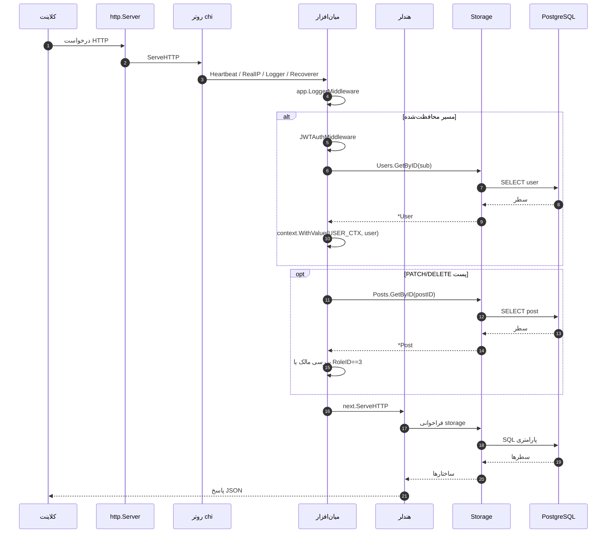

# 02. معماری

## سبک معماری

شادینا یک **مونولیت ماژولار لایه‌ای** است که حول یک سرور `net/http` در Go ساخته شده است. لایه‌ها عبارت‌اند از:

1. **لایه انتقال و برنامه** — `cmd/api`: روتر، میان‌افزار، هندلرها، سیم‌کشی پیکربندی.
2. **انواع درخواست/پاسخ** — `internal/dto`: ساختارهای payload JSON و تگ‌های اعتبارسنجی.
3. **لایه ماندگاری** — `internal/storage`: نمای `Storage` با چهار رابط storage و SQL خام.
4. **بسته‌های پشتیبان** — `internal/auth`، `internal/response`، `internal/utils`، `internal/env`،
   `internal/consts` و بسته تولیدشده `docs`.
5. **دیتابیس** — PostgreSQL، دسترسی از طریق `database/sql` و `lib/pq`.

**هیچ لایه سرویس، لایه دامنه، repository به‌ازای هر موجودیت، unit-of-work یا چارچوب تزریق وابستگی وجود
ندارد.** هندلرها مستقیماً متدهای storage را صدا می‌زنند. تزریق وابستگی، سیم‌کشی دستی سازنده‌ها در
`cmd/api/main.go` است.

## زمینه سیستم

منبع: [system-context.mmd](diagrams/system-context.mmd). هیچ سرویس خارجی پیکربندی نشده است.

## مؤلفه‌ها و مسئولیت‌ها

منبع: [architecture.mmd](diagrams/architecture.mmd).

| مؤلفه | نمادهای کلیدی | مسئولیت |
|---|---|---|
| `cmd/api/main.go` | `main`، `config`، `dbConfig`، `authConfig`، `tokenConfig` | ساخت لاگرها، بارگذاری `.env`، ساخت پیکربندی، باز کردن DB، ساخت storage و authenticator، شروع سرور. |
| `cmd/api/api.go` | `application`، `run` | نگه‌داری وابستگی‌های برنامه و پیکربندی `http.Server` (تایم‌اوت‌ها) و فراداده Swagger زمان اجرا. |
| `cmd/api/router.go` | `mount` | ساخت روتر chi، ثبت میان‌افزار و مسیرها، نصب Swagger. |
| `cmd/api/middleware.go` | `LoggerMiddleware`، `JWTAuthMiddleware`، `GetUserCTX`، `UserPostAccessMiddleware` | لاگ درخواست، احراز هویت bearer، context کاربر، بررسی مالکیت/نقش پست. |
| `cmd/api/auth.go` | `userRegistrationHandler`، `generateTokenHandler` | ثبت‌نام و صدور توکن. |
| `cmd/api/uesrs.go` | `listUsersHandler`، `retrieveUsersHandler` | endpointهای خواندن کاربر. |
| `cmd/api/posts.go` | هندلرهای CRUD + `listPostsHandler` | CRUD پست و جاسازی نظر. |
| `cmd/api/followers.go` | `UserFollowHandler`، `UserUnfollowHandler` | endpointهای دنبال‌کردن/دنبال‌نکردن. |
| `cmd/api/feeds.go` | `listFeedsHandler` | endpoint فید و تجزیه صفحه‌بندی. |
| `cmd/api/health.go` | `healthCheckHandler` | payload زنده‌بودن؛ DB را کوئری نمی‌کند. |
| `internal/auth/auth.go` | `Authenticator` | رابط تولید/اعتبارسنجی توکن. |
| `internal/auth/jwt.go` | `JWTAuthenticator`، `GenerateToken`، `ValidateToken` | پیاده‌سازی HS256 JWT. |
| `internal/storage/storage.go` | `Storage`، `NewPostgresql` | نما و سازنده برای چهار store مشخص. |
| `internal/storage/users.go` | `UsersStorage`، `User`، `HashedPassword`، `ComparePassword` | SQL کاربر + کمک‌تابع‌های bcrypt. |
| `internal/storage/posts.go` | `PostsStorage`، `Post`، `PostWithMetadata`، `GetFeed` | SQL پست و کوئری فید. |
| `internal/storage/comments.go` | `CommentsStorage`، `Comment` | SQL درج/خواندن نظر. |
| `internal/storage/followers.go` | `FollowersStorage`، `Follower` | SQL دنبال‌کردن/دنبال‌نکردن. |
| `internal/storage/pagination.go` | `PaginatedQuery`، `CreatePaginatedQuery`، `Parse` | پارامترهای کوئری فید. توجه: در بسته storage قرار دارد، هرچند تجزیه کوئری HTTP را انجام می‌دهد. |
| `internal/db/db.go` | `NewDB` | باز کردن `sql.DB`، اعمال تنظیمات pool، ping با تایم‌اوت ۱۰ ثانیه. |
| `internal/db/seed.go` | `Seed`، تولیدکننده‌ها | داده seed توسعه؛ `storage` را import می‌کند. |
| `internal/dto` | ساختارهای payload | شکل درخواست JSON و پاسخ سلامت. |
| `internal/env` | `GetString`، `GetInt` | جست‌وجوی محیطی با fallback. |
| `internal/response` | `Response`، `Respond`، کمک‌تابع‌ها | پاکت یکنواخت JSON. |
| `internal/utils` | `ReadJson`، `WriteJson`، `Validate` | محدودیت بدنه ۱ MiB، رد فیلدهای ناشناخته، validator سراسری. |
| `internal/consts` | تایم‌اوت‌ها، `NOT_FOUND`، `USER_CTX` | ثابت‌ها/مقدار sentinel مشترک. |
| `docs` | `SwaggerInfo` | قالب تولیدشده Swagger که `http-swagger` استفاده می‌کند. |
| `cmd/seed` | `main` | ساخت DB + storage و فراخوانی `db.Seed`. |
| `cmd/migrate/migrations` | فایل‌های SQL | تغییرات نسخه‌بندی‌شده schema. |

## گراف وابستگی بسته‌ها

منبع: [package-dependency.mmd](diagrams/package-dependency.mmd). این گراف از خروجی
`go list -f '{{.ImportPath}}|{{join .Imports " "}}' ./...` استخراج شده است، نه از قراردادهای نام‌گذاری.

**بررسی چرخه:** `go list` و `go build ./...` موفق‌اند و هیچ چرخه import بسته وجود ندارد. با این حال یک
وابستگی عمدی‌نما اما قابل‌بحث وجود دارد: `internal/db` بسته `internal/storage` را import می‌کند چون
`internal/db/seed.go` منطق seed دارد. این باعث می‌شود بسته راه‌اندازی دیتابیس به بسته ماندگاری وابسته باشد.

## نقاط ورود

| نقطه ورود | مسیر | کاری که انجام می‌دهد |
|---|---|---|
| سرور API | `cmd/api/main.go` → `main()` | بارگذاری `.env`، ساخت پیکربندی، باز کردن DB، ساخت `application`، فراخوانی `mount()` و `run()`. |
| فرمان seed | `cmd/seed/main.go` → `main()` | بارگذاری `.env`، باز کردن DB، ساخت storage، فراخوانی `db.Seed`. |
| فرمان مهاجرت | — | هیچ `main` Go در `cmd/migrate` نیست؛ مهاجرت‌ها با CLI خارجی `migrate` از `makefile` اعمال می‌شوند. |
| Swagger UI | `cmd/api/router.go` | ارائه مستندات تولیدشده در `/v1/swagger/*`. |

## راه‌اندازی و سیم‌کشی وابستگی

`main()` موارد زیر را به ترتیب انجام می‌دهد:

1. `init()` مقدار `utils.Validate = validator.New(validator.WithRequiredStructEnabled())` را تنظیم می‌کند.
2. پوشه `logs/` را با مجوز `0755` می‌سازد؛ در صورت شکست panic می‌کند.
3. یک `zap.NewProductionConfig()` با خروجی JSON به `logs/app.log` و خروجی خطا به `logs/error.log` می‌سازد.
4. `godotenv.Load()` را صدا می‌زند؛ اگر `.env` وجود نداشته باشد یا خوانده نشود، فرآیند با
   `error loading .env file` خارج می‌شود.
5. مقادیر محیطی را با پیش‌فرض‌ها می‌خواند و `config` را می‌سازد.
6. `db.NewDB(driver, addr, maxOpen, maxIdle, maxIdleTimeout)` را صدا می‌زند؛ شکست `log.Fatalln` را اجرا می‌کند.
7. `*sql.DB` را در `storage.NewPostgresql` می‌پیچد.
8. `auth.NewJWTAuthenticator(secret, issuer, audience)` را می‌سازد.
9. `application{config, storage, logger, authenticator}` را می‌سازد.
10. `app.mount()` را برای ساخت هندلر chi صدا می‌زند.
11. `app.run(&mux)` را صدا می‌زند؛ `run` تایم‌اوت‌های `http.Server` را تنظیم و `ListenAndServe` را اجرا می‌کند.

هیچ خاموشی آرام، مدیریت سیگنال یا فراخوانی `http.Server.Shutdown` وجود ندارد. `log.Fatal` فرآیند را خارج
می‌کند، بنابراین `log.Sync()` و `db.Close()` معوق در پایان سرور اجرا نمی‌شوند.

## چرخه عمر درخواست

منبع: [request-lifecycle.mmd](diagrams/request-lifecycle.mmd). ترتیب کامل میان‌افزار در
[04. جریان برنامه](04-application-flow.md) مستند شده است.

## تصمیم‌های معماری استنباط‌شده از کد

| تصمیم | شاهد | پیامد |
|---|---|---|
| `net/http` استاندارد + chi به‌جای چارچوب | `cmd/api/router.go`، `api.go` | سطح وابستگی کوچک و ترتیب صریح میان‌افزار. |
| تزریق وابستگی دستی | `cmd/api/main.go` هر وابستگی را می‌سازد | بدون جادوی container/چارچوب؛ سیم‌کشی قابل مشاهده اما متمرکز است. |
| نمای storage با رابط‌های بی‌نام | `internal/storage/storage.go` | مصرف‌کننده‌ها به `storage.Storage` وابسته‌اند؛ storeهای مشخص مستقل قابل تزریق نیستند. |
| SQL خام، بدون ORM | `internal/storage/*.go` | کوئری‌ها و ایندکس‌ها صریح‌اند؛ صحت/کارایی کوئری دستی است. |
| JWT HS256 | `internal/auth/jwt.go` | توکن‌های بی‌حالت، راز مشترک، بدون ابطال سمت سرور. |
| bcrypt | `internal/storage/users.go` | هش رمز به‌صورت `bytea` ذخیره می‌شود؛ work factor مقدار `bcrypt.DefaultCost` است. |
| validator سراسری | `internal/utils/validator.go`، `cmd/api/main.go` | فراخوانی اعتبارسنجی آسان است، اما state سراسری پنهان و جداسازی تست سخت‌تر می‌شود. |
| Swagger تولیدشده + هندلر UI | `docs/`، `http-swagger` | Swagger توسط API ارائه می‌شود؛ تولید اکنون شکسته است. |
| مهاجرت‌های PostgreSQL به‌صورت CLI خارجی | `makefile`، `cmd/migrate/migrations` | Schema نسخه‌بندی شده؛ اجرای مهاجرت بخشی از باینری برنامه نیست. |
| Compose فقط برای PostgreSQL | `docker-compose.yaml` | DB محلی کانتینری است؛ API روی میزبان اجرا می‌شود. |

## مشاهدات اتصال و مرزها

- **انتقال ↔ storage:** هندلرها مستقیماً `storage.Storage` را صدا می‌زنند و اغلب ساختارهای storage را به‌عنوان
  پاسخ API سریالایز می‌کنند. بنابراین `storage.User`، `storage.Post` و `storage.Comment` هم‌زمان مدل API هستند و
  قرارداد JSON را به شکل سطر SQL گره می‌زنند. `internal/dto` فقط payloadهای درخواست (به‌علاوه پاسخ سلامت) دارد،
  نه مدل پاسخ.
- **دغدغه‌های HTTP در storage:** `internal/storage/pagination.go` بسته `net/http` را import و پارامترهای query را
  تجزیه می‌کند. این یک دغدغه HTTP داخل بسته ماندگاری است.
- **راه‌اندازی DB ↔ seed:** `internal/db` برای منطق seed بسته `internal/storage` را import می‌کند. بسته تولیدی DB
  معمولاً نباید از تولید fixture خبر داشته باشد.
- **validator سراسری:** هندلرها به مقداردهی `utils.Validate` توسط `init` در `main` وابسته‌اند. تست‌ها یا نقاط ورود
  جایگزین باید آن را مقداردهی کنند وگرنه روی اشاره‌گر nil panic می‌کنند.
- **کلید context:** `GetUserCTX` رشته literal `"user"` را می‌خواند در حالی که `JWTAuthMiddleware` مقدار
  `consts.USER_CTX` (همان `"user"`) را می‌نویسد. مقادیر یکسان‌اند، اما literal شکننده است و `staticcheck` کلید
  رشته‌ای را (`SA1029`) علامت می‌زند.
- **شناسه نقش‌ها:** ثبت‌نام `RoleID: 1` را hard-code می‌کند؛ مجوزدهی ادمین را با `RoleID == 3` hard-code می‌کند.
  این‌ها به شناسه‌های نقش seed‌شده وابسته‌اند و با نام جست‌وجو نمی‌شوند.

## بدهی فنی مشهود در معماری

1. بدون لایه سرویس؛ تصمیم‌های کسب‌وکار (مالکیت، بررسی نقش، ترکیب فید) بین میان‌افزار، هندلرها و SQL تقسیم شده‌اند.
2. بدون مدل خطای نوع‌دار؛ رشته‌های خام `err.Error()` از مرز HTTP عبور می‌کنند.
3. بدون مرز تراکنش برای عملیات چندمرحله‌ای؛ حذف پست می‌تواند شکست بخورد چون نظرها حذف/آبشاری نمی‌شوند.
4. `listPostsHandler` به‌ازای هر پست یک کوئری نظر اجرا می‌کند (N+1).
5. SQL فید مشکلات صحت دارد (شمارش تکراری، نادیده‌گرفتن مرتب‌سازی) و هندلر تضمین نمی‌کند که `userID` مسیر با
   کاربر احراز هویت‌شده یکی باشد.
6. بدون خاموشی آرام، بررسی DB در health، request ID، متریک یا ردیابی.
7. بدون تست خودکار، mock یا CI.
8. تولید Swagger با DTOهای گمشده مسدود شده؛ قرارداد موجود کهنه است.
9. `bin/main` ردیابی می‌شود، `web/` خالی است و `cmd/migrate` نقطه ورود Go ندارد.
10. پیکربندی یک متغیر راز غلط‌املا (`AUTH_SECRET_KAY`) و یک راز fallback hard-code دارد.

اولویت‌بندی رفع در [مرور معماری](../reports/architecture-review.md) آمده است.

## اسناد مرتبط

- [ساختار پروژه](03-project-structure.md)
- [جریان برنامه](04-application-flow.md)
- [طراحی دیتابیس](05-database-design.md)
- [احراز هویت و مجوزدهی](08-authentication-authorization.md)
- [مدیریت خطا](10-error-handling.md)
- [مرور امنیتی](15-security-review.md)
