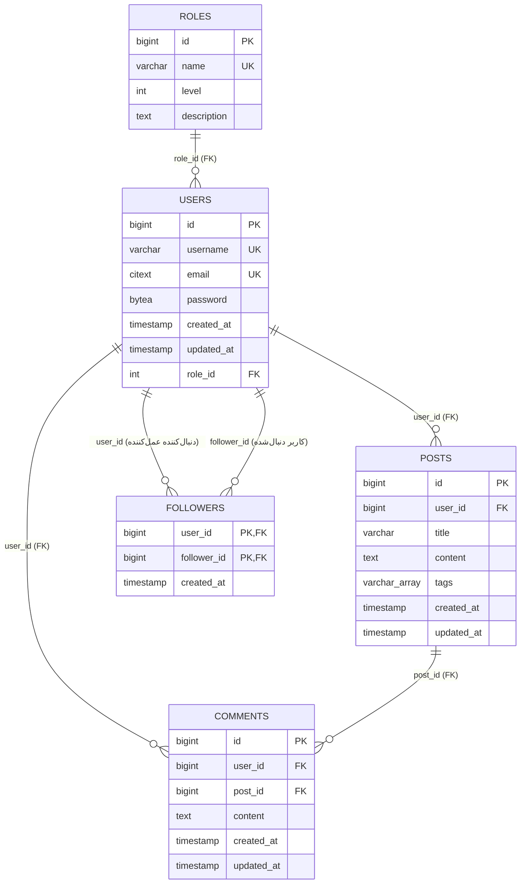

# 05. طراحی دیتابیس

## نمای کلی

شادینا از PostgreSQL استفاده می‌کند (ایمیج Compose برابر `postgres:18.4` است). Schema توسط مهاجرت‌های SQL در
`cmd/migrate/migrations` ساخته می‌شود و با جدول `schema_migrations` در golang-migrate ردیابی می‌شود. در زمان
بررسی، دیتابیس محلی `version = 12` و `dirty = false` گزارش داد.

افزونه‌های تأییدشده: `citext`، `pg_trgm`، `plpgsql`. افزونه `plpgsql` به‌صورت پیش‌فرض نصب است.

Schema از پنج جدول برنامه تشکیل شده است:

| جدول | هدف |
|---|---|
| `roles` | نقش‌های نام‌دار و یک سطح عددی. با `user`، `moderator`، `admin` seed شده است. |
| `users` | حساب‌ها، هش رمز bcrypt، یکتایی ایمیل/نام کاربری، تخصیص نقش. |
| `posts` | پست‌های نوشته‌شده توسط کاربر با عنوان، محتوا، برچسب‌ها، زمان‌ها. |
| `comments` | نظرهای روی پست‌ها، نوشته‌شده توسط کاربران. از طریق پاسخ پست خوانده می‌شوند؛ بدون API نوشتن. |
| `followers` | رابطه‌های جهت‌دار دنبال‌کردن (کلید اصلی مرکب). |

`schema_migrations` توسط ابزار مدیریت می‌شود و جدول برنامه نیست.

## ERD



منبع: [database-erd.mmd](diagrams/database-erd.mmd). نمودار از `timestamp` به‌عنوان شکل کوتاه
`timestamp(0) with time zone` استفاده می‌کند؛ نوع واقعی SQL برابر `timestamp(0) with time zone` است
(timestamptz با دقت ثانیه).

## جدول: `roles`

توسط `000011_add_roles_table.up.sql` ساخته شده است.

| ستون | نوع | تهی‌پذیر | پیش‌فرض | محدودیت‌ها |
|---|---|---:|---|---|
| `id` | `bigserial` | خیر | sequence | کلید اصلی |
| `name` | `varchar(255)` | خیر | — | یکتا (`roles_name_key`) |
| `level` | `integer` | خیر | `0` | — |
| `description` | `text` | بله | — | — |

سطرهای seed درج‌شده توسط مهاجرت:

| id (DB تازه) | name | level | description |
|---:|---|---:|---|
| 1 | `user` | 1 | A user can create posts and comments |
| 2 | `moderator` | 2 | A moderator can update other users posts |
| 3 | `admin` | 3 | An admin can update and delete other users posts |

شناسه‌ها توسط `bigserial` تولید می‌شوند و در دیتابیس تازه به ترتیب درج وابسته‌اند. کد برنامه برای ثبت‌نام
مقدار `1` و برای مجوزدهی ادمین مقدار `3` را hard-code می‌کند، به‌جای جست‌وجو با نام.

## جدول: `users`

توسط `000001_create_users.up.sql` ساخته و با `000012_alter_users_with_roles.up.sql` تغییر کرده است.

| ستون | نوع | تهی‌پذیر | پیش‌فرض | محدودیت‌ها / یادداشت |
|---|---|---:|---|---|
| `id` | `bigserial` | خیر | sequence | کلید اصلی |
| `username` | `varchar(255)` | خیر | — | یکتا (`users_username_key`) |
| `email` | `citext` | خیر | — | یکتا (`users_email_key`)؛ حساس‌نبودن به حروف |
| `password` | `bytea` | خیر | — | بایت‌های هش bcrypt؛ هرگز متن ساده |
| `created_at` | `timestamp(0) with time zone` | خیر | `now()` | — |
| `updated_at` | `timestamp(0) with time zone` | خیر | `now()` | به‌صورت خودکار به‌روز نمی‌شود |
| `role_id` | `integer` | خیر | — | FK به `roles(id)`؛ بدون عمل `ON DELETE` |

ایندکس‌های مشاهده‌شده در schema زنده:

| ایندکس | تعریف | یادداشت |
|---|---|---|
| `users_pkey` | btree (`id`) | کلید اصلی |
| `users_username_key` | btree یکتا (`username`) | یکتایی را اعمال می‌کند |
| `users_email_key` | btree یکتا (`email`) | یکتایی citext را اعمال می‌کند |
| `idx_users_username` | btree (`username`) | زائد با `users_username_key` |
| `users_role_id_fkey` | — | محدودیت FK؛ PostgreSQL به‌صورت خودکار برای آن ایندکس **نمی‌سازد** |

`password` به `storage.User.Password` اسکن می‌شود اما فیلد تگ `json:"-"` دارد، بنابراین سریالایز نمی‌شود.
`role_id` توسط `GetByID`/`GetByEmail` برگردانده می‌شود، اما `UsersStorage.List` آن را انتخاب نمی‌کند؛ بنابراین
پاسخ‌های فهرست `role_id: 0` نشان می‌دهند (تأیید شد).

## جدول: `posts`

توسط `000002_create_posts.up.sql` ساخته و FK آن با `000003_alter_post_table.up.sql` اضافه شده است.

| ستون | نوع | تهی‌پذیر | پیش‌فرض | محدودیت‌ها / یادداشت |
|---|---|---:|---|---|
| `id` | `bigserial` | خیر | sequence | کلید اصلی |
| `user_id` | `bigint` | خیر | — | FK `fk_user_post` → `users(id)`؛ بدون `ON DELETE` |
| `title` | `varchar(255)` | خیر | — | — |
| `content` | `text` | خیر | — | — |
| `tags` | `varchar(255)[]` | بله | — | آرایه PostgreSQL؛ ایندکس GIN |
| `created_at` | `timestamp(0) with time zone` | خیر | `now()` | — |
| `updated_at` | `timestamp(0) with time zone` | خیر | `now()` | به‌صورت خودکار به‌روز نمی‌شود |

ایندکس‌ها:

| ایندکس | تعریف | توسط کد فعلی استفاده می‌شود؟ |
|---|---|---|
| `posts_pkey` | btree (`id`) | جست‌وجو/ویرایش/حذف نقطه‌ای |
| `idx_posts_user_id` | btree (`user_id`) | احتمالاً مفید برای پست‌های کاربر/join فید |
| `idx_posts_title` | GIN (`title gin_trgm_ops`) | از `ILIKE '%search%'` روی عنوان در فید پشتیبانی می‌کند |
| `idx_posts_tags` | GIN (`tags`) | هیچ کوئری فعلی بر اساس برچسب فیلتر نمی‌کند |

هیچ ایندکسی روی `posts.created_at` وجود ندارد، هرچند فید بر اساس آن مرتب می‌کند.

## جدول: `comments`

توسط `000004_create_comments.up.sql` ساخته و FKهای آن با `000005_alter_comments_table.up.sql` اضافه شده‌اند.

| ستون | نوع | تهی‌پذیر | پیش‌فرض | محدودیت‌ها / یادداشت |
|---|---|---:|---|---|
| `id` | `bigserial` | خیر | sequence | کلید اصلی |
| `user_id` | `bigint` | خیر | — | FK `fk_user_comment` → `users(id)`؛ بدون `ON DELETE` |
| `post_id` | `bigint` | خیر | — | FK `fk_post_comment` → `posts(id)`؛ بدون `ON DELETE` |
| `content` | `text` | خیر | — | — |
| `created_at` | `timestamp(0) with time zone` | خیر | `now()` | — |
| `updated_at` | `timestamp(0) with time zone` | خیر | `now()` | به‌صورت خودکار به‌روز نمی‌شود |

ایندکس‌ها:

| ایندکس | تعریف | یادداشت |
|---|---|---|
| `comments_pkey` | btree (`id`) | کلید اصلی |
| `idx_comments_post_id` | btree (`post_id`) | از `GetByPostID` پشتیبانی می‌کند |
| `idx_comments_content` | GIN (`content gin_trgm_ops`) | هیچ کوئری فعلی محتوای نظر را جست‌وجو نمی‌کند |

هیچ ایندکسی روی `comments.user_id` وجود ندارد؛ کوئری‌های فعلی بر اساس آن فیلتر نمی‌کنند.

## جدول: `followers`

توسط `000006_add_followers_table.up.sql` ساخته شده است.

| ستون | نوع | تهی‌پذیر | پیش‌فرض | محدودیت‌ها / یادداشت |
|---|---|---:|---|---|
| `user_id` | `bigint` | خیر | — | FK → `users(id)` با `ON DELETE CASCADE`؛ بخشی از PK مرکب |
| `follower_id` | `bigint` | خیر | — | FK → `users(id)` با `ON DELETE CASCADE`؛ بخشی از PK مرکب |
| `created_at` | `timestamp(0) with time zone` | خیر | `now()` | — |

کلید اصلی: `(user_id, follower_id)`. این از دنبال‌کردن تکراری یک جفت جلوگیری می‌کند.

### دنبال‌کنندگان و جهت

نام ستون‌ها به‌راحتی اشتباه خوانده می‌شوند:

- `user_id` — **دنبال‌کننده عمل‌کننده** (کاربری که دنبال می‌کند).
- `follower_id` — **کاربر دنبال‌شده** (هدف).

`FollowersStorage.Follow(ctx, userID, followerID)` توسط هندلر به‌صورت
`Follow(ctx, authenticatedUser.ID, targetUserID)` فراخوانی می‌شود، بنابراین
`(user_id = authenticated, follower_id = target)` درج می‌شود.

کوئری فید این معنا را تأیید می‌کند:

```sql
JOIN followers f ON f.follower_id = p.user_id OR p.user_id = $1
WHERE f.user_id = $1 OR p.user_id = $1
```

توسعه‌دهنده‌ای که فرض کند `user_id` کاربر دنبال‌شده است، کوئری‌های معکوس می‌نویسد. تا زمانی که مهاجرتی
ستون‌ها را تغییر نام ندهد، این نام‌گذاری باید بخشی از قرارداد دیتابیس تلقی شود.

## رابطه‌ها و یکپارچگی ارجاعی

| رابطه | محدودیت | توسط DB اعمال می‌شود؟ | رفتار حذف |
|---|---|---|---|
| `users.role_id → roles.id` | `users_role_id_fkey` | بله | `NO ACTION` (پیش‌فرض)؛ حذف نقش ارجاع‌شده شکست می‌خورد |
| `posts.user_id → users.id` | `fk_user_post` | بله | `NO ACTION`؛ حذف کاربر دارای پست شکست می‌خورد |
| `comments.user_id → users.id` | `fk_user_comment` | بله | `NO ACTION`؛ حذف کاربر دارای نظر شکست می‌خورد |
| `comments.post_id → posts.id` | `fk_post_comment` | بله | `NO ACTION`؛ حذف پست دارای نظر شکست می‌خورد |
| `followers.user_id → users.id` | `followers_user_id_fkey` | بله | `ON DELETE CASCADE` |
| `followers.follower_id → users.id` | `followers_follower_id_fkey` | بله | `ON DELETE CASCADE` |

همه رابطه‌ها توسط دیتابیس اعمال می‌شوند. هیچ رابطه فقط-برنامه‌ای وجود ندارد. نبود `ON DELETE CASCADE` روی
پست‌ها/نظرها قابل مشاهده است: حذف پستی که نظر دارد `fk_post_comment` را فعال می‌کند و API پاسخ 500 می‌دهد
(در یک تراکنش rollback‌شده تأیید شد).

## زمان‌ها و مناطق زمانی

- همه زمان‌ها از `timestamp(0) with time zone` استفاده می‌کنند؛ PostgreSQL یک لحظه مطلق ذخیره می‌کند.
- پیش‌فرض‌ها در درج `NOW()` هستند.
- `updated_at` توسط trigger یا دستورهای `UPDATE` SQL **نگه‌داری نمی‌شود**. `PostsStorage.Update` فقط `title`
  و `content` را به‌روز می‌کند، بنابراین `updated_at` زمان درج باقی می‌ماند.
- Go زمان‌ها را به `time.Time` اسکن و به‌صورت رشته RFC3339 سریالایز می‌کند (مثلاً `2026-10-17T07:31:18Z`).
- هیچ ستون حذف نرم (`deleted_at`، `is_deleted`) وجود ندارد؛ حذف‌ها فیزیکی‌اند.

## شکل داده seed

`internal/db/seed.go` موارد زیر را تولید می‌کند:

- ۱۰۰ کاربر: نام کاربری/ایمیل‌هایی مانند `alice0`، `bob1`، با `RoleID: 1` و **بدون رمز**.
- ۲۰۰ پست: نویسنده، عنوان، محتوا و دو برچسب تصادفی.
- ۵۰۰ نظر: پست تصادفی، نویسنده تصادفی، محتوای تصادفی.

seed هیچ دنبال‌کننده‌ای نمی‌سازد. دیتابیس توسعه محلی در زمان بررسی شامل
`107 users / 203 posts / 500 comments / 4 followers` بود؛ کاربران/پست‌ها/دنبال‌کنندگان اضافی از استفاده دستی
یا داده‌های قبلی آمده‌اند، نه از اجرای فعلی seed. از شمارش سطرهای زنده، تعداد seed را استنباط نکنید.

کاربران seed‌شده `password = ''::bytea` دارند (تأیید شد: ۱۰۰ سطر). مقایسه bcrypt با هش خالی شکست می‌خورد،
بنابراین کاربران seed‌شده نمی‌توانند توکن بگیرند. برای ساخت کاربر قابل ورود از `POST /v1/auth/register`
استفاده کنید.

## Schema در برابر رفتار برنامه

| واقعیت schema | رفتار برنامه |
|---|---|
| `users.role_id` برابر `NOT NULL` است | ثبت‌نام `RoleID: 1` را hard-code می‌کند؛ اگر نقش ۱ وجود نداشته باشد، درج شکست می‌خورد. |
| `posts.tags` تهی‌پذیر است | `CreatePostPayload.Tags` اختیاری است؛ nil به SQL NULL تبدیل می‌شود. |
| `comments.updated_at` وجود دارد | `Comment.Create` آن را برنمی‌گرداند، بنابراین ساختار نظر تازه‌ساخته تا بازخوانی، `UpdatedAt` صفر دارد. |
| PK جدول `followers` از تکرار جلوگیری می‌کند | `Follow` پیش‌بررسی نمی‌کند؛ دنبال‌کردن تکراری خطای خام نقض یکتایی → 500 برمی‌گرداند. |
| `comments.post_id` آبشار ندارد | حذف پست دارای نظر شکست می‌خورد → 500. |
| `users.email` از نوع `citext` است | مقایسه/یکتایی ایمیل در لایه DB حساس به حروف نیست. |

## اسناد مرتبط

- [عملیات دیتابیس](06-database-operations.md)
- [مرور دیتابیس](../reports/database-review.md)
- [نمودار جریان مهاجرت](diagrams/migration-flow.mmd)
- [مرجع API](07-api-reference.md)
