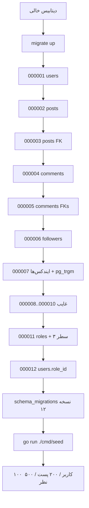

# 06. عملیات دیتابیس

## سازوکار مهاجرت

پروژه از CLI خارجی **golang-migrate** استفاده می‌کند. هیچ اجراکننده مهاجرت داخل باینری API و هیچ
`cmd/migrate/main.go` وجود ندارد. makefile به `./cmd/migrate/migrations` اشاره می‌کند و از `DATABASE_ADDR`
موجود در `.env` استفاده می‌کند (makefile دستور `include .env` و `export` را انجام می‌دهد).

در زمان بررسی:

| مورد | مقدار |
|---|---|
| CLI `migrate` | `4.16.2` |
| مسیر مهاجرت | `./cmd/migrate/migrations` |
| نسخه اعمال‌شده | `12` |
| پرچم dirty | `false` |
| فایل‌های مهاجرت | ۱۸ فایل SQL (۹ جفت up/down) |
| شماره‌های غایب | `000008`، `000009`، `000010` |

`golang-migrate` جدول `schema_migrations(version bigint primary key, dirty boolean)` را در دیتابیس هدف می‌سازد
و نگه‌داری می‌کند.

## فهرست مهاجرت‌ها

| نسخه | مهاجرت up | مهاجرت down | یادداشت |
|---:|---|---|---|
| 000001 | ساخت `citext`؛ ساخت `users` | حذف `users` | down افزونه را حذف نمی‌کند. |
| 000002 | ساخت `posts` | حذف `posts` | `user_id` هنوز FK ندارد. |
| 000003 | افزودن `fk_user_post` روی `posts.user_id` | حذف `fk_user_post` | — |
| 000004 | ساخت `comments` | حذف `comments` | FKها جداگانه اضافه می‌شوند. |
| 000005 | افزودن `fk_user_comment`، `fk_post_comment` | حذف هر دو محدودیت | — |
| 000006 | ساخت `followers` با PK مرکب و FKهای آبشاری | حذف `followers` | — |
| 000007 | ساخت `pg_trgm`؛ افزودن شش ایندکس | حذف شش ایندکس | down افزونه `pg_trgm` را حذف نمی‌کند. |
| 000008–000010 | — | — | وجود ندارند. |
| 000011 | ساخت `roles`؛ درج `user`، `moderator`، `admin` | حذف `roles` | درج‌ها `ON CONFLICT` ندارند. |
| 000012 | افزودن `users.role_id` با پیش‌فرض ۱، backfill با `user`، حذف پیش‌فرض، تنظیم NOT NULL | حذف `users.role_id` | FK به `roles(id)`. |

نسخه‌های غایب ۸–۱۰ برای golang-migrate بی‌ضررند (شماره نسخه دقیق را ردیابی می‌کند)، اما تاریخچه را ناقص نشان
می‌دهند. هیچ مهاجرتی برای داده seed یا `schema_migrations` وجود ندارد.

## فرمان‌ها: هدف، پیش‌نیازها، اثرها

همه فرمان‌های زیر از ریشه مخزن اجرا می‌شوند مگر خلاف آن ذکر شود. makefile فایل `.env` را include می‌کند،
بنابراین اهداف `make` در صورت نبودن یا نامعتبر بودن `.env` شکست می‌خورند.

| فرمان | هدف | پیش‌نیازها | اثرهای جانبی |
|---|---|---|---|
| `make migrate-up` | اعمال همه مهاجرت‌های معلق | CLI `migrate`؛ `.env` با `DATABASE_ADDR`؛ DB قابل دسترس | جدول‌ها و ایندکس‌ها را می‌سازد/تغییر می‌دهد؛ `schema_migrations` را می‌نویسد. روی DB تازه مخرب نیست. |
| `make migrate-down 1` | برگشت یک مهاجرت | همان | **مخرب**: اشیای schema را حذف/برمی‌گرداند. روی داده موردنیاز اجرا نکنید. |
| `make migrate-down` | برگشت همه مهاجرت‌های down (فرمان `down` بدون محدودیت در golang-migrate) | همان | **مخرب**؛ ممکن است همه جدول‌ها را حذف کند. |
| `make migrate-force VERSION=n` | اجبار نسخه schema بدون اجرای SQL | همان | **خطرناک**: می‌تواند مهاجرت‌ها را دور بزند و وضعیت `dirty` را ناسازگار بگذارد. |
| `make migrate-version` | چاپ نسخه فعلی | CLI `migrate`؛ DB | فقط خواندنی. |
| `make migrate-create NAME=x` | ساخت یک جفت فایل مهاجرت | CLI `migrate` | فقط فایل می‌سازد. **هدف فعلی شکسته است**: مقدار `NAME` را به `migrate create` نمی‌دهد؛ از فرمان خام استفاده کنید. |
| `make seed` | قصد seed کردن DB | — | **شکسته**: هدف `go run cmd/migrate/seed/main.go` را اجرا می‌کند که وجود ندارد. DB را تغییر نمی‌دهد. |
| `go run ./cmd/seed` | فرمان واقعی seed | DB مهاجرت‌شده؛ `.env` | کاربر/پست/نظر درج می‌کند؛ idempotent نیست؛ **مرز تراکنش نمی‌سازد**. |
| `make gen-docs` | تولید مجدد Swagger | `swag`؛ انواع ارجاع‌شده در حاشیه‌نویسی‌ها | **اکنون شکست می‌خورد** در `dto.FollowPayload`؛ در اجرای تمیز هیچ فایلی تولید نمی‌شود. |

نمونه‌های خام مهاجرت (معادل اهداف make):

```bash
migrate -path=./cmd/migrate/migrations -database="$DATABASE_ADDR" up
migrate -path=./cmd/migrate/migrations -database="$DATABASE_ADDR" down 1
migrate -path=./cmd/migrate/migrations -database="$DATABASE_ADDR" version
```

هدف `make migrate-create` به این صورت باز می‌شود:

```text
migrate create -seq -ext sql -dir ./cmd/migrate/migrations
```

بدون نام مهاجرت. از این استفاده کنید:

```bash
migrate create -seq -ext sql -dir ./cmd/migrate/migrations add_some_change
```

فقط برای آزمایش مستندات، مهاجرت نسازید/اجرا نکنید.

## نمودار جریان مهاجرت



منبع: [migration-flow.mmd](diagrams/migration-flow.mmd).

## عملیات seed

`cmd/seed/main.go`:

1. `.env` را با `godotenv.Load()` بارگذاری می‌کند.
2. `DATABASE_ADDR`، تنظیمات pool و `DB_DRIVER` را می‌خواند (توجه: **نه** `DATABASE_DRIVER`).
3. `db.NewDB` و `storage.NewPostgresql` را صدا می‌زند.
4. `db.Seed(store, database)` را صدا می‌زند.

`internal/db/seed.go`:

- ۱۰۰ کاربر، ۲۰۰ پست، ۵۰۰ نظر تولید می‌کند.
- ابتدا کاربران، سپس پست‌ها، سپس نظرها را درج می‌کند.
- در اولین خطای درج زود برمی‌گردد.
- از `db.BeginTx` استفاده می‌کند، اما همه متدهای storage از `*sql.DB` خودشان استفاده می‌کنند، نه شیء تراکنش.
  بنابراین تراکنش درج‌ها را **نمی‌پیچد**. `tx.Commit()` یک تراکنش خالی را commit می‌کند؛ شاخه rollback کاربران
  درج‌شده را برنمی‌گرداند. خطاهای `BeginTx` و `Commit` نادیده گرفته می‌شوند.
- رمز تنظیم نمی‌کند. کاربران درج‌شده رمز `bytea` خالی دارند و نمی‌توانند وارد شوند.
- idempotent نیست. اجرای دوم روی اولین نام کاربری/ایمیل تکراری شکست می‌خورد؛ کاربران درج‌شده قبل از شکست
  باقی می‌مانند. پس از آن شکست، پست/نظر تلاش نمی‌شود.

فرمان صحیح:

```bash
go run ./cmd/seed
```

`make seed` قابل استفاده نیست چون به `cmd/migrate/seed/main.go` اشاره می‌کند.

## فهرست کوئری‌های زمان اجرا

همه کوئری‌ها پارامتری‌اند (`$1`، `$2`، ...). برای `tags` از `pq.Array` استفاده می‌شود. هیچ کوئری مقادیر
غیرقابل‌اعتماد را به SQL الحاق نمی‌کند.

| متد storage | عملیات SQL | پارامترها | ایندکس/یادداشت |
|---|---|---|---|
| `UsersStorage.Create` | `INSERT INTO users ... RETURNING id, created_at, updated_at` | username، email، هش bcrypt، role_id | ایندکس‌های یکتا تکرار را اعمال می‌کنند؛ خطاها خام برگردانده می‌شوند. |
| `UsersStorage.List` | `SELECT id, username, email, password, created_at, updated_at FROM users` | هیچ | بدون `role_id`؛ بدون `ORDER BY`؛ بدون صفحه‌بندی. |
| `UsersStorage.GetByID` | `SELECT ... role_id ... WHERE id=$1` | id | کلید اصلی؛ `sql.ErrNoRows` → `consts.NOT_FOUND`. |
| `UsersStorage.GetByEmail` | `SELECT ... WHERE email=$1` | email | ایندکس یکتای `citext`؛ `sql.ErrNoRows` → `consts.NOT_FOUND`. |
| `PostsStorage.Create` | `INSERT INTO posts ... RETURNING id, created_at, updated_at` | user_id، title، content، tags | `tags` می‌تواند NULL باشد. |
| `PostsStorage.List` | `SELECT ... FROM posts` | هیچ | اسکن کل جدول؛ بدون ترتیب/صفحه‌بندی. |
| `PostsStorage.GetByID` | `SELECT ... WHERE id=$1` | id | کلید اصلی. |
| `PostsStorage.Delete` | `DELETE FROM posts WHERE id=$1` | id | `RowsAffected()==0` → `NOT_FOUND`؛ FK نظرها می‌تواند مانع شود. |
| `PostsStorage.Update` | `UPDATE posts SET title=$1, content=$2 WHERE id=$3` | title، content، id | `updated_at` را به‌روز نمی‌کند؛ سطرهای تأثیرگرفته را بررسی نمی‌کند. |
| `PostsStorage.GetFeed` | join/aggregate پیچیده (پایین را ببینید) | userID، sort، limit، offset، search | از `followers`، `comments`، `users`، `posts` استفاده می‌کند؛ یادداشت‌های صحت/کارایی را ببینید. |
| `CommentsStorage.Create` | `INSERT INTO comments ... RETURNING id, created_at` | user_id، post_id، content | `updated_at` برگردانده نمی‌شود. |
| `CommentsStorage.GetByPostID` | `SELECT ... JOIN users ... WHERE c.post_id=$1 ORDER BY c.created_at DESC` | post_id | از `idx_comments_post_id` استفاده می‌کند؛ users را با PK join می‌کند. |
| `FollowersStorage.Follow` | `INSERT INTO followers(user_id, follower_id) VALUES ($1,$2)` | کاربر احراز هویت‌شده، هدف | هدف تکراری/ناشناخته → خطای خام DB. |
| `FollowersStorage.Unfollow` | `DELETE ... WHERE user_id=$1 AND follower_id=$2` | کاربر احراز هویت‌شده، هدف | سطرهای تأثیرگرفته را بررسی نمی‌کند. |

## تحلیل کوئری فید

`PostsStorage.GetFeed` پیچیده‌ترین کوئری است:

```sql
SELECT p.id, p.user_id, p.title, p.content, p.created_at, p.updated_at, p.tags,
       u.username, COUNT(c.id) AS comments_count
FROM posts p
LEFT JOIN comments c ON c.post_id = p.id
LEFT JOIN users u ON p.user_id = u.id
JOIN followers f ON f.follower_id = p.user_id OR p.user_id = $1
WHERE (f.user_id = $1 OR p.user_id = $1)
  AND ($5 = '' OR p.title ILIKE '%' || $5 || '%' OR p.content ILIKE '%' || $5 || '%')
GROUP BY p.id, u.username
ORDER BY p.created_at, $2
LIMIT $3 OFFSET $4
```

منبع: [feed-query.mmd](diagrams/feed-query.mmd).

### مشکلات صحت تأییدشده

1. **تورم شمارش نظر.** برای پست‌های خود کاربر احراز هویت‌شده، شرط `JOIN`
   `f.follower_id = p.user_id OR p.user_id = $1` با هر سطر `followers` مطابقت می‌کند (همه سطرهای دنبال‌کننده،
   نه فقط سطرهای کاربر)، بنابراین `COUNT(c.id)` در تعداد سطرهای followers ضرب می‌شود. در DB محلی، پست `19`
   مقدار `counted = 16` برگرداند در حالی که `COUNT(DISTINCT c.id) = 4` بود. API مقدار متورم را ارائه می‌کند.
2. **بدون پست شخصی اگر `followers` خالی باشد.** چون join یک `JOIN followers` داخلی است، کاربری که هیچ سطری
   در `followers` ندارد هیچ سطری نمی‌گیرد، حتی برای پست‌های خودش. join داخلی حداقل یک سطر دنبال‌کننده در کل
   جدول را الزامی می‌کند.
3. **جهت مرتب‌سازی بی‌اثر است.** `$2` یک پارامتر است، نه شناسه؛ `ORDER BY p.created_at, $2` ابتدا بر اساس
   `created_at` و سپس یک مقدار ثابت مرتب می‌کند. درخواست‌های محلی با `sort=asc` و `sort=desc` ترتیب یکسان
   برگرداندند. `sort` به‌صورت SQL تزریق نمی‌شود (از تزریق ایمن است) اما مرتب‌سازی نمی‌کند.
4. **offset پیش‌فرض ۱۰ است.** `CreatePaginatedQuery(20, 10, "desc")` و نبود تجزیه `page` یعنی صفحه اول ۱۰ سطر
   را رد می‌کند. Swagger می‌گوید `page` پیش‌فرض ۱ و `limit` 20 است؛ کد این‌گونه نیست.
5. **`since`/`until` استفاده نمی‌شوند.** تجزیه و در `PaginatedQuery` ذخیره می‌شوند، اما SQL هرگز از آن‌ها
   استفاده نمی‌کند. `until` حتی قالب‌بندی نمی‌شود.
6. **هر کاربر احراز هویت‌شده می‌تواند هر `userID` را درخواست کند.** هندلر هرگز شناسه مسیر را با کاربر
   احراز هویت‌شده از context مقایسه نمی‌کند.
7. **`limit`/`offset` عددی نامعتبر بی‌صدا نادیده گرفته می‌شوند.** `Parse` در شکست `Atoi` مقدار `*pq, nil`
   برمی‌گرداند و پیش‌فرض‌ها را باقی می‌گذارد؛ فراخوان خطایی دریافت نمی‌کند.
8. **`search` فقط روی عنوان/محتوا کار می‌کند.** `idx_posts_title` به جست‌وجوی عنوان کمک می‌کند؛ هیچ ایندکس
   trigram روی `posts.content` نیست، بنابراین جست‌وجوی محتوا می‌تواند اسکن کامل لازم داشته باشد.
   `idx_comments_content` توسط این کوئری استفاده نمی‌شود.

### مشاهدات کارایی

- join `comments` همه نظرهای هر پست را قبل از صفحه‌بندی جمع می‌کند؛ برای داده‌های بزرگ می‌تواند گران باشد.
  شمارش lateral/همبسته یا یک aggregate جداگانه می‌تواند ارزان‌تر باشد.
- `ORDER BY p.created_at` ایندکس پشتیبان ندارد.
- `followers` کلید اصلی مرکب `(user_id, follower_id)` دارد؛ فیلتر بر اساس `f.user_id` از پیشوند PK استفاده
  می‌کند، اما join فقط بر اساس `f.follower_id` ممکن است از ایندکس استفاده نکند. ایندکس روی
  `(follower_id, user_id)` می‌تواند کمک کند، اما هیچ benchmark اجرا نشد.
- `PostsStorage.List` + `GetByPostID` برای هر پست، N+1 است. با ۲۰۳ پست، حداکثر ۲۰۴ کوئری.
- فهرست `users` و `posts` صفحه‌بندی ندارند؛ اندازه پاسخ با جدول رشد می‌کند.

## تراکنش‌ها

- هندلرهای درخواست از تراکنش صریح استفاده **نمی‌کنند**.
- ویرایش/حذف پست تک‌دستوری‌اند.
- حذف پست دارای نظر در سراسر `comments` و `posts` تراکنشی نیست؛ روی FK شکست می‌خورد.
- تنها `BeginTx` در `internal/db/seed.go` است، اما فراخوانی‌های storage را نمی‌پیچد. عملاً یک تراکنش
  بی‌اثر است.
- هیچ پیکربندی `SERIALIZABLE`/isolation وجود ندارد؛ پیش‌فرض‌های PostgreSQL اعمال می‌شوند.

## استخر اتصال

`internal/db/db.go` فراخوانی می‌کند:

```go
db.SetMaxOpenConns(maxOpenConns)       // پیش‌فرض 30
db.SetMaxIdleConns(maxIdleConns)       // پیش‌فرض 30
db.SetConnMaxIdleTime(duration)        // پیش‌فرض 15m
```

هیچ `SetConnMaxLifetime`، بررسی سلامت دوره‌ای یا تایم‌اوت اتصال به‌ازای هر درخواست فراتر از contextهای توضیح‌داده‌شده
وجود ندارد. `sql.Open` تنبل است؛ `PingContext` راه‌اندازی اتصال را اعتبارسنجی می‌کند.

## ریسک‌های یکپارچگی داده

| ریسک | شاهد | اثر |
|---|---|---|
| هش رمز خالی برای کاربران seed‌شده | `generateUsers` هرگز `Password` را تنظیم نمی‌کند؛ ۱۰۰ سطر با bytea خالی | حساب‌های seed‌شده نمی‌توانند وارد شوند؛ تست‌ها می‌توانند گمراه‌کننده باشند. |
| حذف پست توسط نظرها مسدود می‌شود | FK `fk_post_comment` آبشار ندارد؛ حذف rollback‌شده شکست خورد | `DELETE /v1/posts/{id}` برای بیشتر پست‌های seed‌شده 500 برمی‌گرداند. |
| دنبال‌کردن تکراری 500 برمی‌گرداند | PK `(user_id, follower_id)` + بدون پیش‌بررسی | قرارداد API می‌گوید 404/400 اما 500 برمی‌گردد. |
| هدف دنبال‌کردن ناشناخته 500 برمی‌گرداند | FK + بدون نگاشت `NOT_FOUND` | همان. |
| شناسه نقش‌ها hard-code شده | ثبت‌نام `RoleID: 1`؛ ادمین `RoleID == 3` | در صورت تغییر شناسه‌ها شکننده است. |
| `updated_at` کهنه | بدون trigger؛ SQL ویرایش آن را حذف می‌کند | کلاینت‌ها نمی‌توانند از `updated_at` برای ابطال کش استفاده کنند. |
| شمارش فید متورم | تکرار join | `comment_count` اشتباه برای پست‌های شخصی. |
| seed اتمی/idempotent نیست | تراکنش بی‌اثر؛ بازگشت زودهنگام | داده ناقص پس از شکست/اجرای مجدد. |
| `scripts/init_db.sql` نامعتبر | `CREATE DATABASE IF NOT EXISTS` در PostgreSQL پشتیبانی نمی‌شود | اسکریپت در شکل نوشته‌شده قابل استفاده نیست. |
| شکاف مهاجرت ۸–۱۰ | فایل‌ها غایب | سردرگمی ظاهری/تاریخی؛ بدون مشکل عملکردی. |

## توصیه‌ها

**P0 — صحت**

1. کوئری فید را اصلاح کنید: برای followers از `LEFT JOIN`/`EXISTS`، از `COUNT(DISTINCT c.id)` و اعمال جهت
   مرتب‌سازی با `CASE`/`ORDER BY` لیست‌سفید (هرگز الحاق رشته) استفاده کنید.
2. درباره معنای حذف پست تصمیم بگیرید: `ON DELETE CASCADE` برای نظرها، یا حذف نظرها در یک تراکنش، یا
   برگرداندن تعارض به‌جای 500.
3. `RowsAffected` را برای unfollow/update بررسی و رابطه غایب را به 404 نگاشت کنید.
4. در دستورهای update مقدار `updated_at = NOW()` را تنظیم کنید یا از trigger استفاده کنید.
5. `UsersStorage.List` را برای انتخاب `role_id` اصلاح کنید؛ ترتیب/صفحه‌بندی اضافه کنید.
6. شناسه‌های hard-code شده نقش را با جست‌وجو بر اساس `roles.name` جایگزین کنید.

**P1 — قابلیت اطمینان**

1. seed را idempotent یا صریحاً مخرب کنید؛ رمزهای تولیدشده را هش کنید یا حساب‌ها را صریحاً غیرقابل‌ورود
   علامت بزنید؛ از تراکنش واقعی استفاده کنید (`tx` به storeها پاس شود).
2. اصلاح `make seed`/`make migrate-create` را اضافه کنید.
3. پس از اندازه‌گیری query plan، ایندکس‌هایی برای ترتیب/الگوی join فید اضافه کنید.
4. در صورت نیاز کوئری‌ها، ایندکس FK (`users.role_id`، `comments.user_id`) اضافه کنید.
5. `idx_users_username` زائد را حذف کنید.
6. تست مهاجرت و بررسی مهاجرت در CI اضافه کنید.

**P2 — کارایی/نگه‌داری**

1. صفحه‌بندی به posts/users اضافه کنید.
2. بارگذاری N+1 نظرها را با یک aggregate/join یا کوئری دسته‌ای جایگزین کنید.
3. ایندکس trigram استفاده‌نشده روی `comments.content` را حذف کنید یا ویژگی جست‌وجوی نظر اضافه کنید.
4. در صورت نیاز triggerهای `updated_at` و ستون‌های audit اضافه کنید.

## اسناد مرتبط

- [طراحی دیتابیس](05-database-design.md)
- [مرور دیتابیس](../reports/database-review.md)
- [راهنمای توسعه](13-development-guide.md)
- [عیب‌یابی](16-troubleshooting.md)
