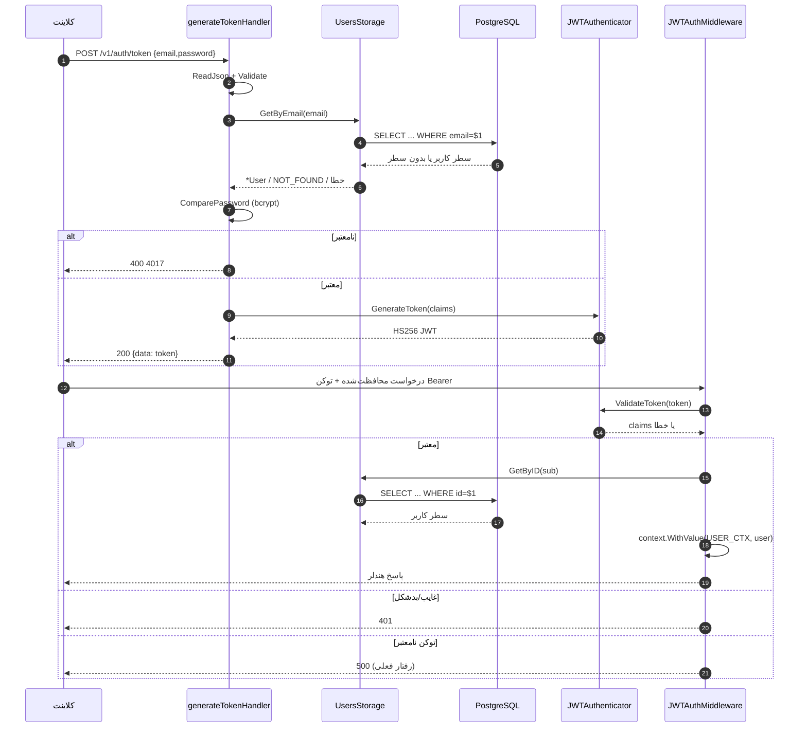

# 08. احراز هویت و مجوزدهی

## خلاصه

| جنبه | پیاده‌سازی |
|---|---|
| طرح احراز هویت | Bearer JWT در هدر `Authorization` |
| امضای توکن | HMAC-SHA256 (`HS256`) |
| صادرکننده/مخاطب توکن | `Shadina` / `Shadina` (hard-code) |
| عمر توکن | ۷۲ ساعت (`24h * 3` hard-code) |
| Claims | `sub`، `exp`، `iat`، `nbf`، `iss`، `aud` |
| هش رمز | bcrypt (`bcrypt.DefaultCost`) |
| Refresh token | **پیاده‌سازی نشده** |
| خروج / ابطال | **پیاده‌سازی نشده** |
| ذخیره توکن | سمت کلاینت؛ بدون جدول session سمت سرور |
| نقش‌ها | جدول `roles` seed‌شده؛ ثبت‌نام نقش ۱ را hard-code می‌کند؛ بررسی ادمین نقش ۳ را hard-code می‌کند |
| مسیرهای عمومی | register، token، health، Swagger، `/ping` |
| مسیرهای محافظت‌شده | همه `/v1/users/*` و `/v1/posts/*` |

## ثبت‌نام و ذخیره رمز

`POST /v1/auth/register` مقدار `dto.UserRegisterPayload` را می‌پذیرد:

```go
type UserRegisterPayload struct {
    Email    string `json:"email" validate:"required,max=255"`
    Username string `json:"username" validate:"required,max=255"`
    Password string `json:"password" validate:"required,min=8,max=255"`
}
```

هندلر:

1. JSON را با محدودیت ۱ MiB و `DisallowUnknownFields` رمزگشایی می‌کند.
2. فیلدهای الزامی و طول رمز (۸–۲۵۵) را اعتبارسنجی می‌کند.
3. `storage.User{Email, Username, RoleID: 1}` را می‌سازد.
4. `user.HashedPassword(payload.Password)` → `bcrypt.GenerateFromPassword(..., bcrypt.DefaultCost)` را صدا می‌زند.
5. کاربر را درج می‌کند؛ هش در `users.password` (`bytea`) ذخیره می‌شود.
6. کاربر را با حذف `password` از JSON برمی‌گرداند.

شکاف‌های قابل توجه اعتبارسنجی:

- هیچ validator قالب `email` وجود ندارد؛ رشته‌هایی مانند `not-an-email` از validator ساختار عبور می‌کنند.
- هیچ قاعده کاراکتر/فاصله برای نام کاربری وجود ندارد.
- هیچ پیش‌بررسی تکراری وجود ندارد؛ نقض یکتایی به‌صورت HTTP 500 با متن خام دیتابیس ظاهر می‌شود.
- طول رمز توسط validator با کاراکتر سنجیده می‌شود، در حالی که bcrypt محدودیت ورودی ۷۲ بایت دارد؛ رمزهای
  بسیار بلند می‌توانند هش را شکست دهند و 500 برگردانند.
- فرض می‌شود شناسه نقش `1` همان نقش `user` است. مهاجرت نقش‌ها را به ترتیب درج می‌کند، اما کد با نام
  جست‌وجو نمی‌کند.

## صدور توکن

`POST /v1/auth/token`:

1. `dto.GenerateTokenPayload` را می‌خواند و اعتبارسنجی می‌کند.
2. کاربر را با ایمیل بارگذاری می‌کند (مقایسه `citext`).
3. رمز ارائه‌شده را با هش bcrypt ذخیره‌شده مقایسه می‌کند.
4. `jwt.MapClaims` را می‌سازد:

```go
claims := jwt.MapClaims{
    "sub": user.ID,
    "exp": time.Now().Add(app.config.auth.token.exp).Unix(),
    "iat": time.Now().Unix(),
    "nbf": time.Now().Unix(),
    "iss": app.config.auth.token.iss, // "Shadina"
    "aud": app.config.auth.token.aud, // "Shadina"
}
```

5. با `jwt.NewWithClaims(jwt.SigningMethodHS256, claims)` و `token.SignedString([]byte(secret))` امضا می‌کند.
6. رشته توکن را در `data` برمی‌گرداند.

راز از `AUTH_SECRET_KAY` می‌آید. نام متغیر یک غلط املایی دارد (`KAY`، نه `KEY`). اگر تنظیم نشده باشد، کد به
یک مقدار توسعه hard-code شده fallback می‌کند. هیچ اعتبارسنجی راه‌اندازی که راز قوی بخواهد وجود ندارد و
`.example.env` هیچ‌کدام از دو املاء را تعریف نمی‌کند.

`exp` در `cmd/api/main.go` به ۷۲ ساعت hard-code شده است؛ از طریق محیط قابل پیکربندی نیست. هیچ refresh token،
انقضای لغزان، `jti`، اتصال دستگاه یا فهرست ابطال وجود ندارد. توکن دزدیده‌شده تا انقضا معتبر می‌ماند مگر اینکه
راز امضا چرخش کند (که همه توکن‌ها را باطل می‌کند).

## اعتبارسنجی توکن

`JWTAuthMiddleware` (اعمال‌شده روی `/v1/users/*` و `/v1/posts/*`):

1. `Authorization` را می‌خواند.
2. دقیقاً دو بخش جداشده با فاصله و `parts[0] == "Bearer"` (حساس به حروف) را الزامی می‌کند. فاصله‌های متعدد
   یا `bearer` با حروف کوچک بدشکل رد می‌شوند.
3. `JWTAuthenticator.ValidateToken` را صدا می‌زند:

```go
jwt.Parse(token, keyFunc,
    jwt.WithIssuer("Shadina"),
    jwt.WithAudience("Shadina"),
    jwt.WithExpirationRequired(),
    jwt.WithValidMethods([]string{jwt.SigningMethodHS256.Name}),
)
```

تابع کلید نیز روش‌های امضای غیر-HMAC را رد می‌کند. `jwt/v5` به‌صورت پیش‌فرض `nbf` را اعتبارسنجی می‌کند.
هیچ پیکربندی تحمل اختلاف ساعت و هیچ بررسی `WithIssuedAt` وجود ندارد.

4. `claims["sub"]` را استخراج، با `fmt.Sprintf("%.f", ...)` قالب‌بندی و به‌صورت `int64` تجزیه می‌کند.
5. کاربر را با شناسه از PostgreSQL بارگذاری می‌کند. کاربر در هر درخواست دریافت می‌شود، بنابراین تغییرات نقش
   فوراً اعمال می‌شوند.
6. `*storage.User` را در context درخواست زیر `consts.USER_CTX` (`"user"`) ذخیره می‌کند.
7. هندلر بعدی را صدا می‌زند.

### رفتار شکست احراز هویت

| شرط | HTTP | کد داخلی | پیام |
|---|---:|---:|---|
| هدر `Authorization` غایب | 401 | 4019 | `authorization header is missing` |
| دقیقاً `Bearer <token>` نیست | 401 | 4020 | `authorization header is malformed` |
| امضای نامعتبر، توکن منقضی، issuer/audience اشتباه، الگوریتم اشتباه | **500** | 5019 | خطای خام parser JWT |
| `sub` غایب/غیرقابل تجزیه | 401 | 4021 | خطای خام `strconv` |
| شکست جست‌وجوی کاربر (شامل قطعی DB) | 401 | 4022 | متن خام خطا |
| توکن معتبر، هندلر موفق | 200 | کد هندلر | — |

برگرداندن 500 برای توکن نامعتبر/منقضی یک مشکل قرارداد و مشاهده‌پذیری است: کلاینت‌ها ممکن است retry کنند و
monitoring شکست‌های احراز هویت را خطای سرور می‌شمارد. پیام می‌تواند جزئیات parser را افشا کند.

## مدل مجوزدهی

### نقش‌ها

جدول `roles` با این مقادیر seed می‌شود:

| شناسه (تازه) | نام | سطح | توضیح موردنظر |
|---:|---|---:|---|
| 1 | `user` | 1 | می‌تواند پست و نظر بسازد |
| 2 | `moderator` | 2 | می‌تواند پست سایر کاربران را ویرایش کند |
| 3 | `admin` | 3 | می‌تواند پست سایر کاربران را ویرایش و حذف کند |

هیچ API مدیریت نقش وجود ندارد. `JWTAuthMiddleware` نقش‌ها را در توکن قرار نمی‌دهد؛ `role_id` را در هر
درخواست از دیتابیس بارگذاری می‌کند.

### میان‌افزار مالکیت پست

`UserPostAccessMiddleware` فقط روی `PATCH` و `DELETE /v1/posts/{postID}` اعمال می‌شود:

```text
دریافت پست
اگر پست یافت نشد -> 404 (4001)
اگر user.ID == post.UserID -> ادامه
اگر user.RoleID == 3:
    next.ServeHTTP(w, r)      // هندلر اجرا می‌شود
    UnauthorizedResponse(...) // سپس به‌هرحال 401 می‌نویسد
    return
UnauthorizedResponse("access denied", 4023)
```

پیامدها:

- **مالک:** مجاز.
- **ادمین (`role_id=3`):** هندلر اجرا می‌شود، اما میان‌افزار سپس تلاش می‌کند بعد از پاسخ هندلر 401 بنویسد.
  در `net/http` در Go، اولین `WriteHeader` برنده است؛ دومی بی‌اثر است (و ممکن است بدنه JSON دوم ضمیمه شود).
  عملیات ممکن است اعمال شود در حالی که پاسخ گمراه‌کننده/خراب است. این با بررسی کد تأیید شد؛ هیچ کاربر ادمین
  در دیتابیس توسعه برای آزمایش سرتاسری وجود نداشت.
- **مدیر (`role_id=2`):** رد می‌شود، با وجود اینکه توضیح نقش می‌گوید مدیران می‌توانند پست سایر کاربران را
  ویرایش کنند.
- **کاربر دیگر:** 401 `access denied`، نه 403.

### دسترسی فید

`GET /v1/users/{userID}/feeds` به JWT معتبر نیاز دارد اما `userID` مسیر را با کاربر احراز هویت‌شده مقایسه
نمی‌کند. هر کاربر احراز هویت‌شده می‌تواند فید هر کاربری را بخواند. اینکه آیا این به‌عنوان تایم‌لاین عمومی
در نظر گرفته شده، تصمیم محصول است؛ کد هیچ بررسی مجوزدهی صریحی ندارد.

### دنبال‌کردن/دنبال‌نکردن

هر کاربر احراز هویت‌شده می‌تواند هر کاربر دیگر (شامل خودش) را دنبال یا دنبال‌نکردن کند. هیچ لیست مسدود،
جریان تأیید یا بررسی نقش وجود ندارد.

## توالی احراز هویت



منابع: [authentication-flow.mmd](diagrams/authentication-flow.mmd)،
[authorization-flow.mmd](diagrams/authorization-flow.mmd).

## مشاهدات امنیتی

| مشاهده | شاهد | اثر |
|---|---|---|
| راز امضای پیش‌فرض | `env.GetString("AUTH_SECRET_KAY", <fallback hard-code>)`؛ `.env`/`.example.env` متغیر را تعریف نمی‌کنند | اگر fallback در محیط قابل دسترس استفاده شود، هر کسی که منبع را بداند می‌تواند توکن جعل کند. |
| کلید env غلط‌املا | `AUTH_SECRET_KAY` در `cmd/api/main.go` | `AUTH_SECRET_KEY` با نام صحیح نادیده گرفته می‌شود؛ اپراتورها ممکن است فکر کنند راز تنظیم شده در حالی که نیست. |
| توکن نامعتبر → 500 | `JWTAuthMiddleware` برای خطاهای `ValidateToken` مقدار `InternalErrorResponse` را صدا می‌زند | شکست‌های احراز هویت بدطبقه‌بندی‌شده، طوفان retry، افشای جزئیات parser. |
| خطاهای خام به کلاینت | `err.Error()` در بسیاری از هندلرها/میان‌افزار | جزئیات دیتابیس/schema/parser می‌تواند افشا شود. |
| بدون ابطال توکن | بدون `jti`، blacklist، جدول session یا logout | توکن دزدیده‌شده تا ۷۲ ساعت معتبر است. |
| بدون جریان refresh | بدون endpoint refresh یا چرخش | UX ضعیف یا توکن‌های طولانی‌عمر؛ بدون چرخش. |
| بدون محدودیت نرخ/قفل | بدون میان‌افزار برای `/auth/token` یا `/auth/register` | حدس آنلاین رمز و سوءاستفاده ثبت‌نام توسط برنامه کاهش نمی‌یابد. |
| بدون اعتبارسنجی ایمیل | فقط `validate:"required,max=255"` | حساب‌های نامعتبر ساخته می‌شوند؛ مشکلات تکراری/قالب به DB/برنامه منتقل می‌شوند. |
| نشانه‌های شمارش کاربر | پیام/کدهای not-found و رمز اشتباه متفاوت‌اند | مهاجم ممکن است ایمیل‌های موجود را تشخیص دهد. |
| نوشتن دوگانه میان‌افزار ادمین | `next.ServeHTTP` و سپس `UnauthorizedResponse` | خرابی پاسخ مجوزدهی؛ عملیات ادمین ممکن است غیرمنتظره اجرا شود. |
| دسترسی بین‌کاربری فید | بدون مقایسه مسیر/کاربر | افشای افقی داده بسته به قصد محصول. |
| بدون CORS/TLS/هدر امنیتی | بدون میان‌افزار CORS؛ بدون پیکربندی TLS | کلاینت‌های cross-origin مرورگر پشتیبانی نمی‌شوند؛ TLS باید جای دیگری خاتمه یابد. |
| هش رمز | bcrypt DefaultCost | پایه معقول؛ cost قابل پیکربندی نیست. |

این یک ارزیابی مرور کد است، نه تست نفوذ. هیچ بهره‌برداری، fuzzing، اسکن آسیب‌پذیری وابستگی یا بررسی
پیکربندی تولید انجام نشد. به [مرور امنیتی](../reports/security-review.md) مراجعه کنید.

## پیاده‌سازی‌نشده

- Refresh token، چرخش، ابطال، خروج.
- بازنشانی/تغییر رمز، تأیید ایمیل.
- MFA.
- قفل حساب، محدودیت نرخ، CAPTCHA.
- مدیریت نقش یا جدول مجوز فراتر از `role_id`.
- audience توکن به‌ازای هر کلاینت، scopeها یا مجوزهای ریزدانه.
- محافظت CSRF (توکن‌های bearer کوکی‌محور نیستند، بنابراین CSRF کلاسیک کمتر مرتبط است، اما احراز هویت
  کوکی وجود ندارد).
- لاگ audit تصمیم‌های احراز هویت/مجوزدهی.

## توصیه‌ها

1. `AUTH_SECRET_KAY` را الزامی کنید (یا به `AUTH_SECRET_KEY` تغییر نام دهید) با مقدار قوی و اگر غایب/ضعیف
   است راه‌اندازی را متوقف کنید.
2. برای همه توکن‌های نامعتبر/منقضی 401 برگردانید و از بازتاب خطاهای parser/DB پرهیز کنید.
3. شاخه ادمین را اصلاح کنید تا بعد از `next.ServeHTTP` مقدار `return` داشته باشد؛ مجوزهای مدیر را صریح
   تعریف کنید.
4. بررسی مالکیت فید در سطح مسیر اضافه کنید یا آن را عمومی مستند کنید.
5. محدودیت نرخ و قفل ورود اضافه کنید.
6. قالب ایمیل را اعتبارسنجی و نام کاربری/ایمیل را به‌طور سازگار نرمال کنید.
7. اگر session طولانی لازم است refresh/چرخش/ابطال اضافه کنید.
8. تست‌هایی برای توکن غایب/بدشکل/منقضی، دسترسی مالک/ادمین/کاربر دیگر و دنبال‌کردن تکراری اضافه کنید.

## اسناد مرتبط

- [مرجع API](07-api-reference.md)
- [پیکربندی](09-configuration.md)
- [مرور امنیتی](15-security-review.md)
- [مدیریت خطا](10-error-handling.md)
