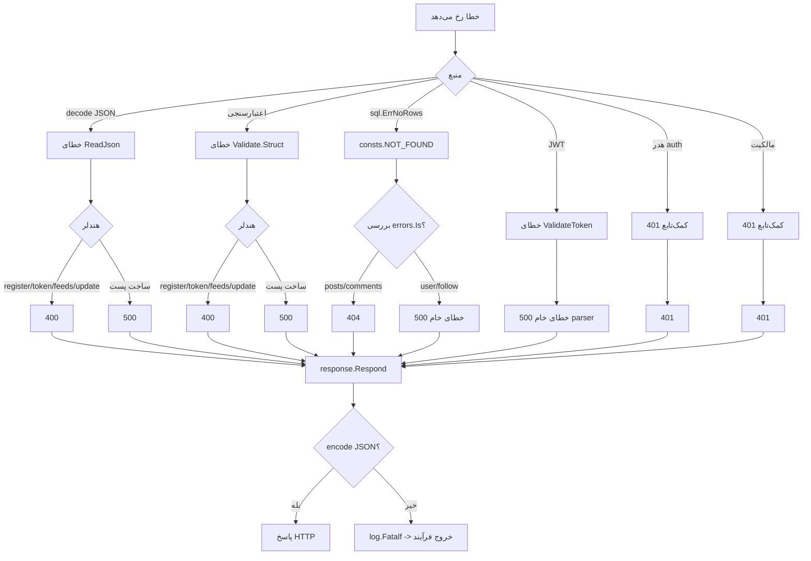

# 10. مدیریت خطا

## پاکت پاسخ

همه پاسخ‌های هندلری که از `internal/response` استفاده می‌کنند این شکل را دارند:

```json
{
  "success": true,
  "message": "human-readable message",
  "internal_code": 1001,
  "data": {}
}
```

| فیلد | نوع | معنا |
|---|---|---|
| `success` | boolean | برای کمک‌تابع‌های موفقیت `true`، برای خطا `false` |
| `message` | string | پیام قابل خواندن؛ ممکن است متن خام خطای داخلی داشته باشد |
| `internal_code` | integer | کد برنامه؛ وضعیت HTTP نیست |
| `data` | any | payload در موفقیت؛ در خطاهای کمک‌تابع فعلی همیشه `null` |

`internal/response/response.go` این‌ها را پیاده‌سازی می‌کند:

| کمک‌تابع | وضعیت HTTP | `success` |
|---|---:|---|
| `SuccessResponse` | 200 | true |
| `CreatedResponse` | 201 | true (تعریف‌شده اما استفاده‌نشده) |
| `BadRequestResponse` | 400 | false |
| `UnauthorizedResponse` | 401 | false |
| `ForbiddenResponse` | 403 | false (تعریف‌شده اما استفاده‌نشده) |
| `NotFoundResponse` | 404 | false |
| `InternalErrorResponse` | 500 | false |

`Respond` هدر `Content-Type: application/json` را تنظیم، وضعیت را می‌نویسد و پاکت را encode می‌کند. اگر encode
شکست بخورد، `log.Fatalf` را صدا می‌زند که فرآیند را پایان می‌دهد؛ `http.Error` بعدی غیرقابل‌دسترسی است. با
انواع داده فعلی این بعید است، اما یک ریسک دسترس‌پذیری است.

برخی پاسخ‌ها پاکت را دور می‌زنند:

- `GET /v1/health` مقدار `dto.HealthStatusPayload` را مستقیماً با `utils.WriteJson` می‌نویسد.
- `/ping` متن `.` با `text/plain` برمی‌گرداند.
- پاسخ‌های پیش‌فرض 404/405 در chi متن ساده‌اند.
- دارایی‌های Swagger HTML/JS/JSON هستند.

## فهرست کدهای داخلی

### کدهای موفقیت

| کد | پیام | استفاده‌کننده |
|---:|---|---|
| 1001 | posts retrieved successfully | `GET /v1/posts` |
| 1002 | post created successfully | `POST /v1/posts` |
| 1003 | post retrieved successfully | `GET /v1/posts/{postID}` |
| 1004 | post deleted successfully / post updated successfully | `DELETE` و `PATCH /v1/posts/{postID}` (تداخل) |
| 1005 | users retrieved successfully | `GET /v1/users` |
| 1006 | user retrieved successfully | `GET /v1/users/{userID}` |
| 1007 | user followed successfully | `PUT .../follow` |
| 1008 | user unfollowed successfully | `PUT .../unfollow` |
| 1009 | feeds retrieved successfully | `GET .../feeds` |
| 1010 | user registered successfully | `POST /v1/auth/register` |
| 1011 | generate token successfully | `POST /v1/auth/token` |

### کدهای خطا

| کد | HTTP | منبع پیام | استفاده‌کننده |
|---:|---:|---|---|
| 4001 | 404 | `post not found` | دریافت/حذف/دسترسی ویرایش پست |
| 4002 | 404 | `not found` | هندلر ویرایش، دریافت پست |
| 4003 | 400 | `request invalid` | decode JSON ویرایش |
| 4004 | 400 | `request invalid` | اعتبارسنجی ویرایش |
| 4006 | 404 | `not found` | شاخه follow؛ **غیرقابل دسترسی** (storage خطاهای خام DB برمی‌گرداند) |
| 4008 | 404 | `not found` | شاخه unfollow؛ **غیرقابل دسترسی** (RowsAffected بررسی نمی‌شود) |
| 4009 | 400 | `err.Error()` | تجزیه صفحه‌بندی فید |
| 4010 | 400 | `err.Error()` | اعتبارسنجی صفحه‌بندی فید |
| 4011 | 400 | `invalid request` | decode JSON ثبت‌نام |
| 4012 | 400 | `err.Error()` | اعتبارسنجی ثبت‌نام |
| 4013 | 400 | `invalid request` | decode JSON توکن |
| 4014 | 400 | `invalid request` | اعتبارسنجی توکن |
| 4015 | 400 | `invalid request` | کاربر توکن یافت نشد |
| 4016 | 400 | `invalid request` | خطای DB توکن |
| 4017 | 400 | `invalid email or password` | رمز اشتباه |
| 4018 | 400 | `invalid request` | خطای امضای توکن |
| 4019 | 401 | `authorization header is missing` | میان‌افزار JWT |
| 4020 | 401 | `authorization header is malformed` | میان‌افزار JWT |
| 4021 | 401 | `err.Error()` | شکست تجزیه `sub` |
| 4022 | 401 | `err.Error()` | شکست جست‌وجوی کاربر پس از توکن |
| 4023 | 401 | `access denied` | مالکیت پست |
| 5001 | 500 | `err.Error()` | فهرست پست‌ها |
| 5002 | 500 | `err.Error()` | JSON ساخت پست |
| 5003 | 500 | `err.Error()` | DB ساخت پست |
| 5004 | 500 | `err.Error()` | تجزیه شناسه پست (دریافت/میان‌افزار) |
| 5005 | 500 | `err.Error()` | دریافت پست (دریافت/میان‌افزار) |
| 5006 | 500 | `err.Error()` | اعتبارسنجی ساخت پست |
| 5007 | 500 | `err.Error()` | تجزیه شناسه پست (حذف/ویرایش) |
| 5008 | 500 | `err.Error()` | DB حذف/ویرایش |
| 5009 | 500 | `err.Error()` | دریافت نظرها؛ همچنین فهرست کاربران |
| 5010 | 500 | `err.Error()` | تجزیه شناسه/دریافت کاربر |
| 5013 | 500 | `err.Error()` | DB follow |
| 5015 | 500 | `err.Error()` | DB unfollow |
| 5016 | 500 | `err.Error()` | تجزیه شناسه مسیر فید |
| 5017 | 500 | `err.Error()` | DB فید |
| 5018 | 500 | `failed to hash password` یا `err.Error()` | هش/DB ثبت‌نام (تداخل) |
| 5019 | 500 | `err.Error()` | اعتبارسنجی JWT |
| 5020 | 500 | `err.Error()` | تجزیه شناسه مسیر follow |
| 5021 | 500 | `err.Error()` | تجزیه شناسه مسیر unfollow |

استفاده‌نشده/شکاف‌ها: 4005، 4007، 5011، 5012، 5014 و هر کد بالای 5021 استفاده نمی‌شوند. کدها دستی تخصیص
می‌یابند و تداخل دارند (1004، 5004، 5005، 5008، 5009، 5010، 5018). هیچ فهرست مرکزی کد یا کاتالوگ خطای
ماشین‌خوان وجود ندارد.

## جریان نگاشت خطا



منبع: [error-handling.mmd](diagrams/error-handling.mmd).

## ناسازگاری‌ها

1. **اعتبارسنجی گاهی 400 و گاهی 500 است.** ثبت‌نام/توکن/فید/ویرایش از 400 استفاده می‌کنند؛ ساخت پست از 500
   (`5006`). قرارداد Swagger برای ساخت پست 400 می‌گوید.
2. **یافت‌نشدن گاهی 404 و گاهی 500 است.** پست‌ها/نظرها `consts.NOT_FOUND` را نگاشت می‌کنند؛ کاربران/follow
   نمی‌کنند. `GET /v1/users/999999` پاسخ 500 کد `5010` می‌دهد.
3. **توکن نامعتبر 500 است، نه 401.** `JWTAuthMiddleware` برای خطاهای parser از `InternalErrorResponse`
   استفاده می‌کند.
4. **خطاهای خام داخلی برگردانده می‌شوند.** مثال‌های تأییدشده محلی:
   - توکن نامعتبر: `"token is malformed: token contains an invalid number of segments"` (500/5019)
   - شناسه کاربر غیرعددی: `"strconv.ParseInt: parsing \"abc\": invalid syntax"` (500/5010)
   - کاربر غایب: `"not found"` (500/5010)
   - بدنه خالی ساخت پست: `"EOF"` (500/5002)
   - پیام‌های اعتبارسنجی شامل نام struct/field هستند.
5. **خطاهای دیتابیس می‌توانند جزئیات schema را افشا کنند.** `err.Error()` از `lib/pq` می‌تواند نام
   محدودیت‌ها، جدول/ستون و در برخی خطاها مقادیر را شامل شود.
6. **شاخه‌های 404 مرده.** follow/unfollow کدهای 404 اعلام می‌کنند اما storage هرگز `consts.NOT_FOUND`
   برنمی‌گرداند.
7. **unfollow برای no-op موفقیت گزارش می‌کند.** `RowsAffected` نادیده گرفته می‌شود.
8. **401 در برابر 403.** شکست مالکیت 401 برمی‌گرداند، نه 403.
9. **خطاهای پیش‌فرض chi پاکت ندارند.** 404/405 می‌تواند کلاینت‌های انتظار JSON را بشکند.
10. **`log.Fatalf` در شکست encode** می‌تواند سرور را به‌جای برگرداندن 500 پایان دهد.

## مثال‌ها

### پاسخ موفق

```json
{"success":true,"message":"post retrieved successfully","internal_code":1003,"data":{...}}
```

### خطای اعتبارسنجی (ثبت‌نام)

```json
{
  "success": false,
  "message": "Key: 'UserRegisterPayload.Username' Error:Field validation for 'Username' failed on the 'required' tag",
  "internal_code": 4012,
  "data": null
}
```

### خطای احراز هویت (هدر غایب)

```json
{"success":false,"message":"authorization header is missing","internal_code":4019,"data":null}
```

### توکن نامعتبر (رفتار فعلی)

```json
{
  "success": false,
  "message": "token is malformed: token contains an invalid number of segments",
  "internal_code": 5019,
  "data": null
}
```

### یافت‌نشدن (رفتار فعلی برای کاربران)

```json
{"success":false,"message":"not found","internal_code":5010,"data":null}
```

## توصیه‌ها

1. خطاهای نوع‌دار برنامه (validation، unauthorized، forbidden، not found، conflict، internal) و یک نگاشت‌کننده
   HTTP واحد معرفی کنید.
2. برای توکن نامعتبر/منقضی 401 برگردانید؛ برای اقدامات احراز هویت‌شده اما ممنوع 403.
3. خطای داخلی کامل را با request ID لاگ کنید؛ به کلاینت پیام عمومی به‌همراه شناسه همبستگی برگردانید.
4. برای همه شکست‌های ورودی/اعتبارسنجی (شامل ساخت پست) 400 و برای ساخت‌ها 201 استفاده کنید، یا Swagger را با
   قرارداد انتخابی هم‌راست کنید.
5. `log.Fatalf` در `Respond` را با پاسخ 500 لاگ‌شده جایگزین کنید.
6. `errors.Is` را به‌طور سازگار استفاده و از storage/follow عملیات `consts.NOT_FOUND` برگردانید جایی که هندلر
   404 اعلام می‌کند.
7. هندلرهای JSON برای 404/405 اضافه کنید.
8. فهرست مرکزی کد خطا با کدهای بدون تداخل و تست اضافه کنید.

## اسناد مرتبط

- [مرجع API](07-api-reference.md)
- [احراز هویت و مجوزدهی](08-authentication-authorization.md)
- [لاگ‌نویسی و مشاهده‌پذیری](11-logging-observability.md)
- [مرور امنیتی](../reports/security-review.md)
