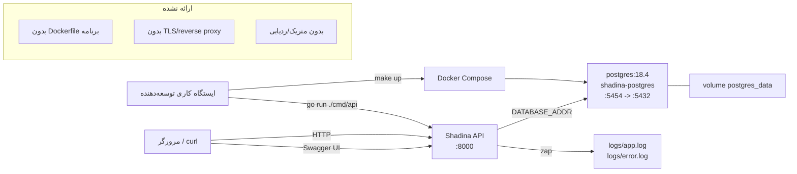

# 12. Docker و استقرار

## Docker Compose واقعاً چه چیزی اجرا می‌کند

`docker-compose.yaml` **فقط PostgreSQL** را تعریف می‌کند:

```yaml
services:
  postgresql:
    container_name: shadina-postgres
    image: postgres:18.4
    restart: always
    environment:
      POSTGRES_USER: user
      POSTGRES_PASSWORD: password
      POSTGRES_DB: shadina_db
    ports:
      - "5454:5432"
    volumes:
      - postgres_data:/var/lib/postgresql

volumes:
  postgres_data:
```

| ویژگی | مقدار |
|---|---|
| نام کانتینر | `shadina-postgres` |
| ایمیج | `postgres:18.4` |
| پورت میزبان | `5454` → کانتینر `5432` |
| دیتابیس | `shadina_db` |
| کاربر/رمز توسعه | inline در فایل Compose تعریف شده؛ خارج از توسعه محلی استفاده نکنید |
| Volume | `postgres_data` نصب‌شده در `/var/lib/postgresql` |
| سیاست restart | `always` |
| healthcheck | **هیچ** |
| سرویس برنامه | **هیچ** |
| Dockerfile | **هیچ در مخزن** |
| job مهاجرت/seed | **هیچ** |

API به‌صورت فرآیند میزبان (`go run ./cmd/api`) اجرا می‌شود، نه در Compose. بنابراین `make up` فقط دیتابیس را
شروع می‌کند.

## نمودار استقرار



منبع: [deployment.mmd](diagrams/deployment.mmd).

## استقرار محلی پشتیبانی‌شده

### پیش‌نیازها

- Go 1.25.4 (از `go.mod`).
- Docker + Docker Compose.
- CLI `migrate` (golang-migrate) برای مهاجرت‌ها.
- `swag` فقط اگر نیاز به تولید مجدد Swagger دارید (اکنون مسدود است).
- فایل `.env` (از `.example.env` کپی و ویرایش کنید؛ به [پیکربندی](09-configuration.md) مراجعه کنید).

### مراحل

```bash
# ۱. قبل از بازنویسی هر چیزی، فایل env موجود را بررسی کنید
ls -l .env .example.env

# ۲. اگر .env وجود ندارد بسازید، سپس مقادیر را ویرایش کنید
cp .example.env .env
# SERVER_URL و AUTH_SECRET_KAY را اضافه کنید؛ مطمئن شوید DATABASE_ADDR از پورت 5454/shadina_db استفاده می‌کند.

# ۳. PostgreSQL را شروع کنید
docker compose up -d        # یا: make up-back (پیش‌زمینه: make up)

# ۴. مهاجرت‌ها را اعمال کنید (نیازمند CLI migrate)
make migrate-up

# ۵. داده توسعه seed کنید (هدف make شکسته است؛ از فرمان واقعی استفاده کنید)
go run ./cmd/seed

# ۶. API را اجرا کنید
go run ./cmd/api

# ۷. زنده‌بودن را بررسی کنید (DB را بررسی نمی‌کند)
curl -sS http://127.0.0.1:8000/v1/health
curl -sS http://127.0.0.1:8000/ping
```

مرحله ۵ را روی دیتابیسی که داده موردنیاز دارد اجرا نکنید: seed idempotent نیست و fixture درج می‌کند. `.env`
موجود را بدون بررسی بازنویسی نکنید.

### رفتار راه‌اندازی مورد انتظار

- API پوشه `logs/` را می‌سازد و خطوط راه‌اندازی را در `logs/app.log` می‌نویسد.
- در راه‌اندازی به PostgreSQL ping می‌زند؛ شکست فوراً خارج می‌شود.
- سرور روی `SERVER_ADDR` (پیش‌فرض `:8000`) گوش می‌دهد.
- `make up`/`docker compose up` فقط PostgreSQL را شروع می‌کند؛ API فرآیندی جداگانه است.

## Build

```bash
# ساخت API در مسیر موقت (bin/main ردیابی‌شده را بازنویسی نمی‌کند)
go build -o /tmp/shadina-api ./cmd/api

# ساخت همه بسته‌ها (cmd/migrate رد می‌شود چون فایل Go ندارد)
go build ./...

# اختیاری: ساخت باینری seed
go build -o /tmp/shadina-seed ./cmd/seed
```

`go build ./cmd/migrate` با `no Go files in .../cmd/migrate` شکست می‌خورد؛ مهاجرت‌ها با CLI خارجی اعمال
می‌شوند. `bin/main` یک باینری ردیابی‌شده ۲۷ مگابایتی است و ممکن است کهنه باشد؛ build تازه را ترجیح دهید.

## اهداف Make

| هدف | کاری که می‌کند | اثر داده |
|---|---|---|
| `make help` | فهرست اهداف را چاپ می‌کند | هیچ، اما `.env` باید وجود داشته باشد چون makefile آن را include می‌کند. |
| `make up` | `docker compose up --build` (پیش‌زمینه؛ فقط PostgreSQL) | کانتینر DB را شروع/به‌روز می‌کند؛ volume حفظ می‌شود. |
| `make up-back` | `docker compose up --build -d` | همان، detached. |
| `make down` | `docker compose down` | کانتینرها و شبکه پیش‌فرض را متوقف/حذف می‌کند؛ volume نام‌دار حفظ می‌شود. |
| `make build` | `docker compose build` | ایمیج‌های Compose را می‌سازد؛ فقط PostgreSQL ایمیج دارد، بنابراین ایمیج برنامه ساخته نمی‌شود. |
| `make logs` | `docker compose logs -f` | فقط خواندنی؛ فقط لاگ DB. |
| `make restart` | `docker compose down && docker compose up --build` | کانتینرها را بازسازی می‌کند؛ volume نام‌دار حفظ می‌شود. |
| `make migrate-up` | golang-migrate up | تغییرات schema؛ `schema_migrations` را می‌نویسد. |
| `make migrate-down 1` | golang-migrate down 1 | **مخرب**: rollback schema. |
| `make migrate-force VERSION=n` | golang-migrate force | **خطرناک**؛ می‌تواند schema/نسخه را ناهمگام کند. |
| `make seed` | مسیر شکسته `cmd/migrate/seed/main.go` | شکست می‌خورد؛ بدون تغییر DB. |
| `go run ./cmd/seed` | seed واقعی | fixture درج می‌کند؛ idempotent نیست. |
| `make test` | `go test -v ./...` | بدون فایل تست؛ با کد ۰ خارج می‌شود. |
| `make lint` | `gofmt -s -w .` سپس `golangci-lint run ./...` | **قالب‌بندی منبع را تغییر می‌دهد**، سپس ۱۲ مشکل lint گزارش می‌کند. |
| `make format` | `gofmt -s -w .` | قالب‌بندی منبع را تغییر می‌دهد. |
| `make gen-docs` | `swag init ...` | **اکنون شکست می‌خورد** در `dto.FollowPayload` گمشده؛ فرض نکنید مستندات تولید مجدد می‌شوند. |

### فرمان‌های مخرب که بدون تأیید صریح نباید اجرا شوند

- `docker compose down -v` / `docker volume rm shadina_postgres_data`: volume دیتابیس را حذف می‌کند.
- `migrate down` (بدون محدودیت) / `make migrate-down`: اشیای schema را حذف می‌کند.
- `migrate force`: می‌تواند نسخه را بدون اعمال SQL علامت بزند.
- `TRUNCATE`، `DROP TABLE` یا `DELETE` دستی روی دیتابیس توسعه.

## شکاف‌های استقرار تولید

مخزن استقرار تولید ارائه نمی‌دهد. قطعات گمشده شامل:

- Dockerfile و ایمیج برنامه (build چندمرحله‌ای، کاربر غیر-root، healthcheck).
- process manager/واحد systemd یا manifestهای Kubernetes.
- jobهای مهاجرت و seed به‌عنوان بخشی از استقرار.
- reverse proxy/خاتمه‌دهنده TLS (nginx، Traefik، Caddy، LB ابری).
- سیاست CORS برای کلاینت‌های مرورگر.
- تزریق/چرخش راز (vault/KMS/secret manager).
- خاموشی آرام و probeهای آمادگی.
- تجمیع لاگ، چرخش، متریک، ردیابی، هشدار.
- پشتیبان‌گیری، بازیابی نقطه‌ای و تمرین restore.
- محدودیت منابع، autoscaling و سیاست‌های شبکه.
- اسکن آسیب‌پذیری وابستگی/کانتینر و SBOM.
- runbook rollback مهاجرت و چک‌لیست انتشار.

`docker-compose.yaml` یک **دیتابیس توسعه** است، نه توپولوژی تولید. اعتبارنامه‌های توسعه inline نباید دوباره
استفاده شوند.

## تأیید استقرار انجام‌شده

| بررسی | نتیجه |
|---|---|
| تجزیه `docker compose config` | موفق؛ یک سرویس (`postgresql`)، یک volume. |
| کانتینر PostgreSQL در حال اجرا | بله (`shadina-postgres`، `postgres:18.4`، پورت میزبان 5454) در زمان بررسی. |
| Build API | `go build ./...` موفق؛ `./cmd/migrate` فایل Go ندارد. |
| API محلی اجرا شد | بله، باینری موقت؛ بررسی health/swagger/auth انجام شد. |
| استقرار تولید | انجام نشد؛ بدون manifest/اعتبارنامه. |
| ساخت ایمیج کانتینر برای API | ممکن نبود؛ بدون Dockerfile. |

## اسناد مرتبط

- [پیکربندی](09-configuration.md)
- [راهنمای توسعه](13-development-guide.md)
- [عملیات دیتابیس](06-database-operations.md)
- [عیب‌یابی](16-troubleshooting.md)
